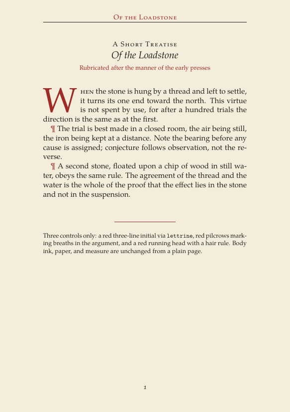
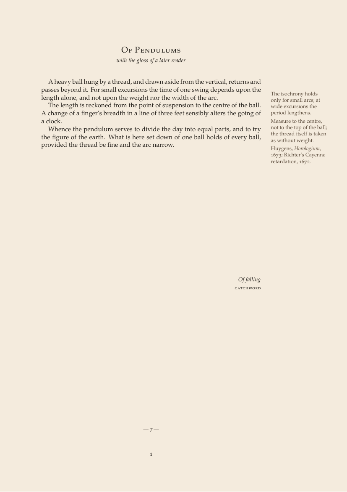
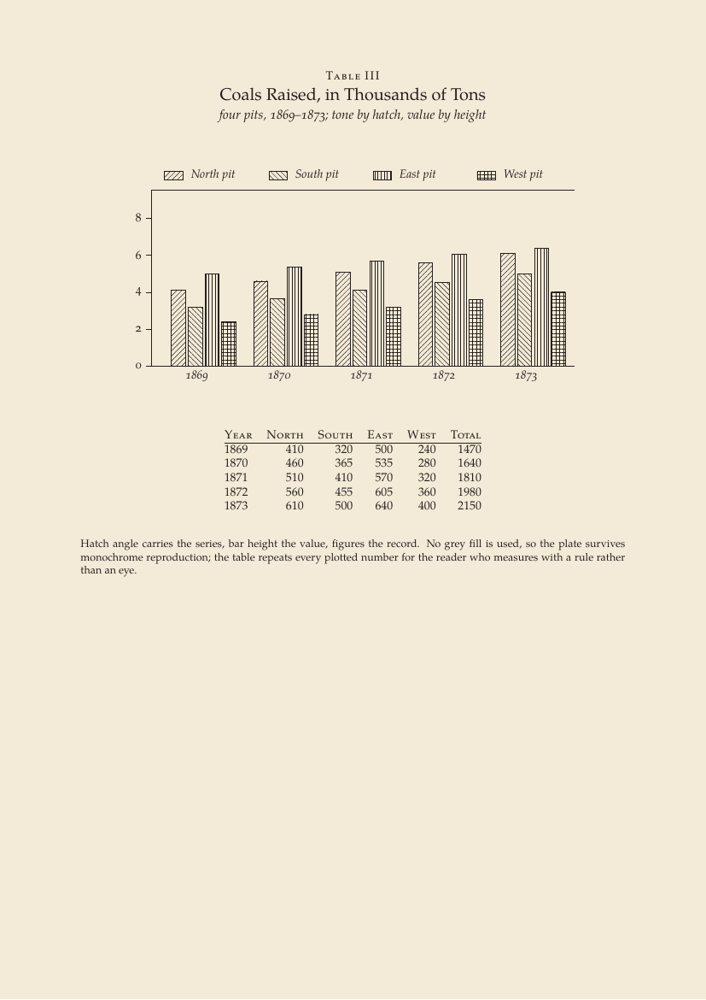

# latex-atlas

Exploratory LaTeX styling lab: small standalone examples behind
period-inspired and preprint-ready aesthetics. Companion to
`vintage-latex` (`/home/jeans/scratch/tmp/vintage-latex`), kept separate so
this repo can grow toward reusable website preprint styles.

Each file in `examples/` is standalone: copy one, compile with LuaLaTeX,
remove effects to see what they contribute.

## Gallery

| | | |
|:-:|:-:|:-:|
|  |  |  |
| 01 rubricated incipit | 02 marginal scholia | 03 hatched bar chart |

## Examples

| no | file | what it isolates |
|----|------|------------------|
| 01 | `01-rubricated-incipit.tex` | two-colour rubrication: red initial, pilcrows, running head |
| 02 | `02-marginal-scholia.tex` | wide-margin scholia page: sidenotes, catchword, folio |
| 03 | `03-hatched-bar-chart.tex` | monochrome data chart: hatched bars, no colour fill |

## Build

```sh
./build.sh
./build.sh 01-rubricated-incipit  # subset
```

Requirements: LuaLaTeX (TeX Live 2026), `fontspec`, `geometry`,
`microtype`, `xcolor`, `tikz` (+ `patterns.meta`), `fancyhdr`,
`lettrine`. EB Garamond if present, else TeX Gyre Pagella fallback
(this machine has only the latter; CI/full TeX Live gets the former).

## Toward website preprints

Kept as a standalone lab for now. When a treatment proves itself here,
it graduates to a shared `.sty` for preprints exported to
`levineuwirth.org` (sources live in `~/Repos/research/meyniel`, export
via `make export`). No vault (`~/universum`) material enters this repo.

## License

CC BY-SA 4.0, see `LICENSE`. Third-party deps (e.g. `fiziko` if later
examples use it) are not relicensed here.
