# latex-atlas

A LaTeX styling lab, currently exploring **Beamer presentations**. The
first Atlas theme brings Garamond text and math, small-cap headings,
rubric, and a warm background to ordinary Beamer slides.

**Direction reset, 2026-11-03:** the previous design decisions and intended
work are shelved and superseded. Beamer is the current investigation;
further exploration will follow what it teaches us. The older plates,
article styles, and verse work remain available as experiments, rather
than a roadmap or constraints on the new work.

## Beamer

```latex
\documentclass[aspectratio=169,12pt]{beamer}
\usetheme{Atlas}
\title{A presentation}
\author{Your name}
\date{}
\begin{document}
\begin{frame}[plain,noframenumbering]
  \titlepage
\end{frame}
\begin{frame}{An observation}
  Ordinary Beamer content, including math, blocks, and overlays.
\end{frame}
\end{document}
```

Compile with **LuaLaTeX**, with `sty/` on `TEXINPUTS`, twice to resolve
references and the frame count. The theme is `sty/beamerthemeAtlas.sty`;
load it with `\usetheme{Atlas}`. It is independent of the article packages
`atlas` and `atlas-grand`; do not load those in a presentation.

Build [the specimen deck](presentations/atlas.tex) from the repository:

```sh
./build-beamer.sh                     # build/beamer/atlas.pdf
./build-beamer.sh --plain             # atlas-plain.pdf: black on white
./build-beamer.sh --handout           # atlas-handout.pdf: collapsed overlays
./build-beamer.sh --plain --handout   # atlas-plain-handout.pdf
```

For your own deck, point to this repository's `sty/` directory:

```sh
TEXINPUTS=/path/to/latex-atlas/sty: lualatex talk.tex
TEXINPUTS=/path/to/latex-atlas/sty: lualatex talk.tex
```

The first version styles the title page, frame titles and subtitles,
numbered theorems, proofs, lists, blocks, and frame numbers. Beamer keeps
control of sections, references, overlays, and page size. The specimen
uses 16:9 at 12 pt; those are document options, not theme requirements.
The title frame above is unnumbered, and overlays share a frame number.

The specimen now includes an argument in motion: a large theorem statement,
a six-step cop-and-robber chase on a fixed tree, and a diagram beside a
three-step proof. Advance PDF pages to move through the overlays; these are
speaker-paced steps, with no timer or special PDF animation support needed.
The cop and robber have distinct lettered pieces, while halos and dashed
branches show the shrinking region. The handout keeps an intermediate
position and a table of the complete chase, followed by the full proof.
These slide patterns live in [presentations/tree-pursuit.tex](presentations/tree-pursuit.tex)
and use ordinary Beamer and TikZ commands, independently of the theme.

Use `\usetheme[plain]{Atlas}` for black on white and the Beamer class's
`handout` option to collapse overlays. These are independent choices.
Customize individual elements with normal `\setbeamercolor`,
`\setbeamerfont`, and `\setbeamertemplate` calls after loading the theme.
The named colors are `AtlasPaper`, `AtlasInk`, and `AtlasRubric`.

Requirements: LuaLaTeX, Beamer, `fontspec`, `unicode-math`, EB Garamond
and Garamond-Math (with TeX Gyre Pagella and Pagella Math as fallbacks).
The specimen also uses TikZ and `booktabs`. This is an initial theme for
visual exploration; projection readability still needs an actual room.

## The grand edition

`\usetheme{AtlasGrand}` is the maximalist investigation: gilded double
borders and corner ornaments, laid and chain lines, illuminated initials,
framed theorem blocks, marginal scholia, Roman folios, and dark astronomical
chapter openings. It loads the Beamer `Atlas` theme, not the old article
package `atlas-grand`.

[The grand specimen](presentations/atlas-grand.tex) expands the argument
into an engraved mathematical atlas. Its illustrations include an armillary
frontispiece, medallion player pieces, a seven-segment countdown dial,
hatched territory bars, and animated one- and two-cop cycle plates.
Everything is vector; the overlays advance with the speaker. The handout
keeps a single coherent position and the whole argument on each frame.

```sh
./build-beamer.sh --grand                     # atlas-grand.pdf
./build-beamer.sh --grand --handout           # atlas-grand-handout.pdf
./build-beamer.sh --grand --plain             # atlas-grand-plain.pdf
./build-beamer.sh --grand --plain --handout   # atlas-grand-plain-handout.pdf
python3 tools/preview_grand.py                # gallery + vector PDF overview
```

All PDFs are in `build/beamer/`. Grand builds take three LuaLaTeX passes
to settle the positions of the page ornaments. The preview command makes
`atlas-grand-overview.pdf`, a nine-plate contact sheet, and the gallery
below. It requires Poppler and pdfLaTeX (the latter only combines existing
PDF pages). Preview selections follow text in the deck, rather than fixed
page numbers.

| Frontispiece | Chapter opening | Proposition |
|:-:|:-:|:-:|
| 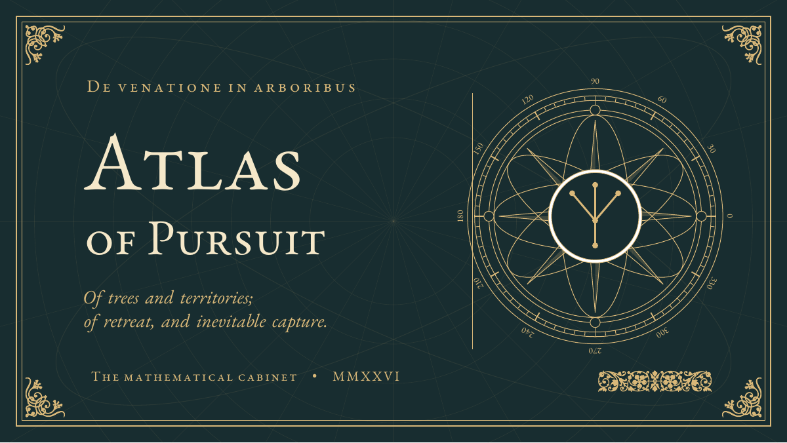 | 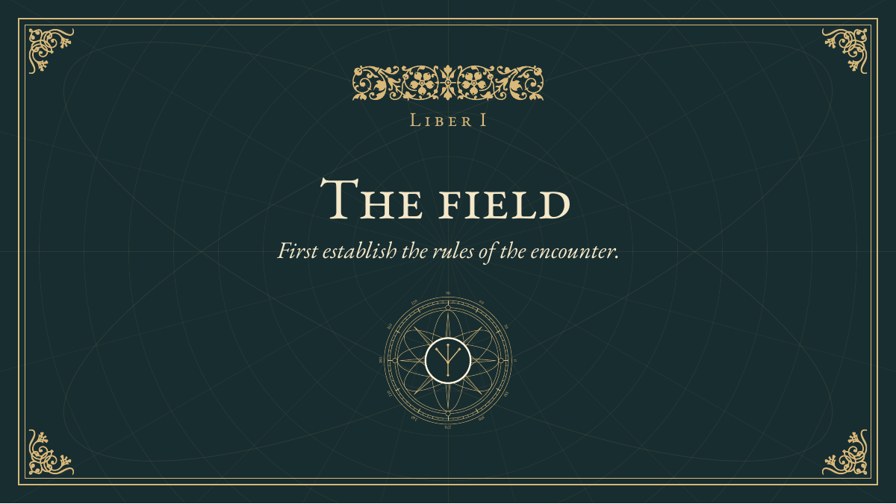 | 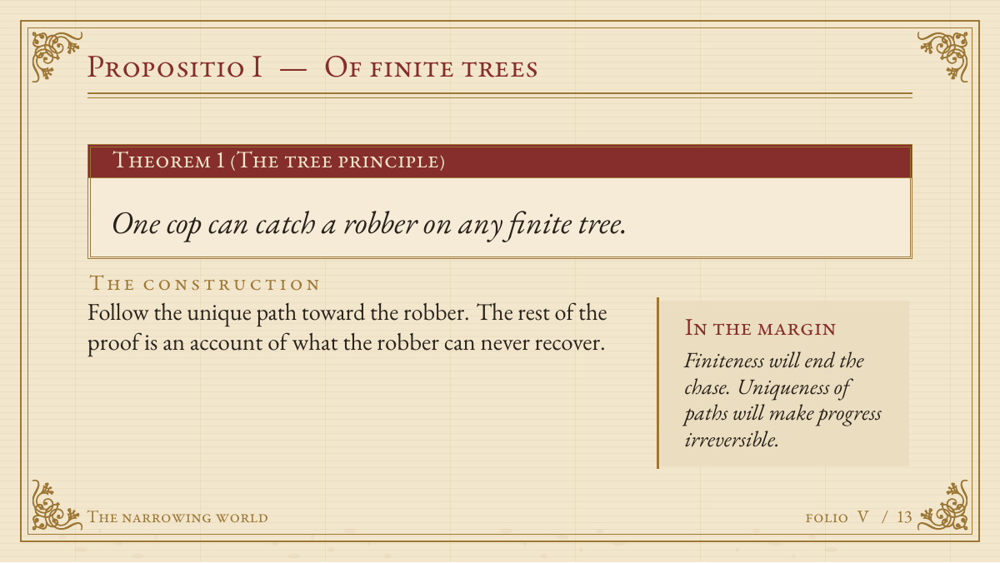 |
| Chase | Working proof | Hatched chart |
| 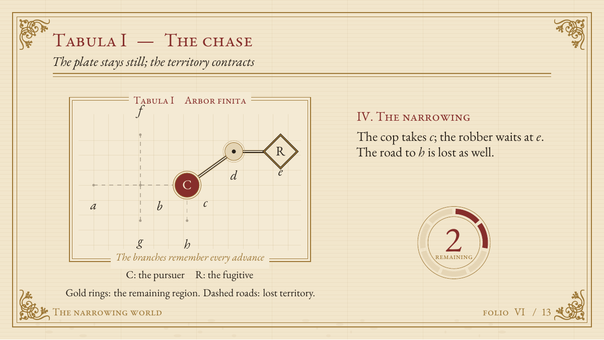 | 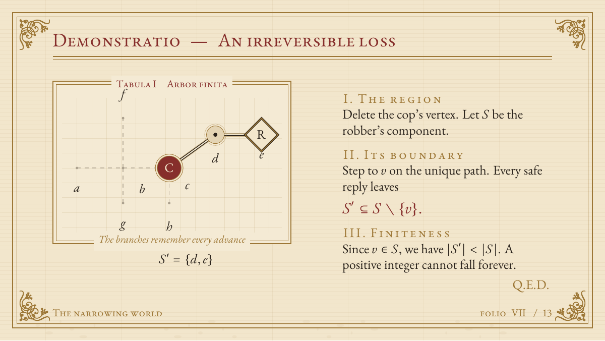 | 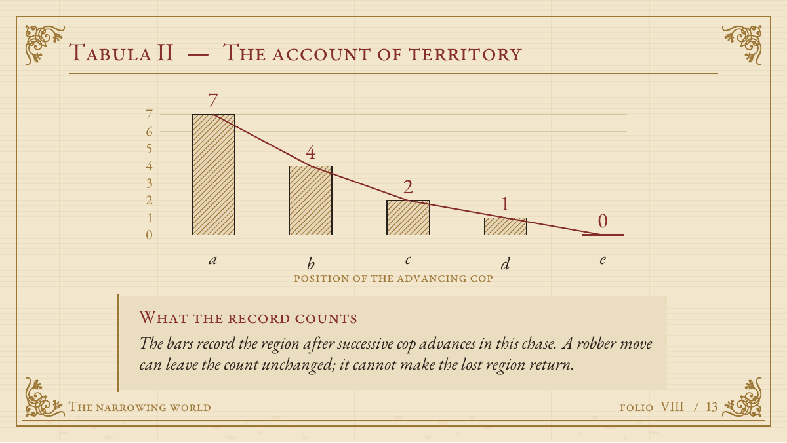 |
| Two boundaries | Marginalia | Finis |
| 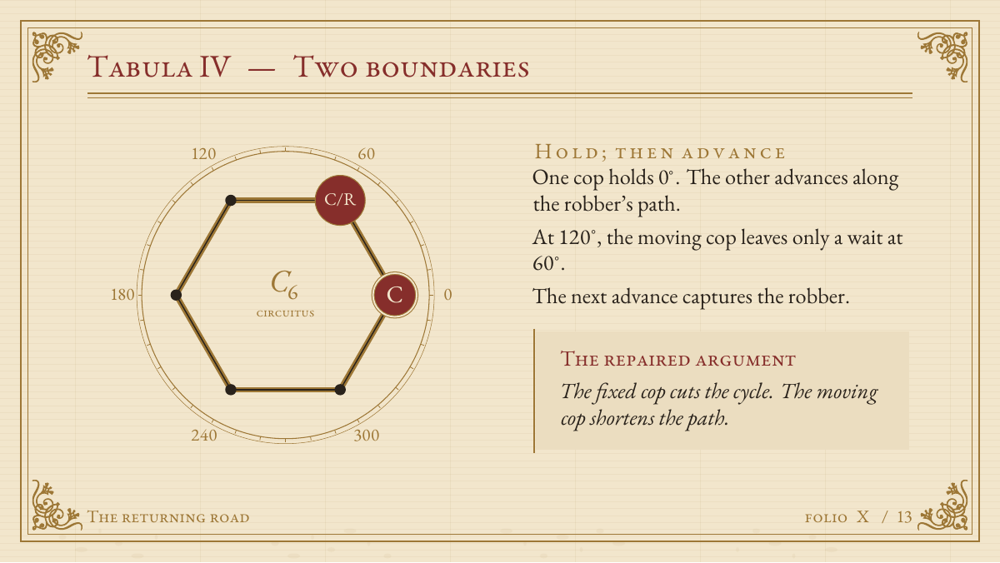 | 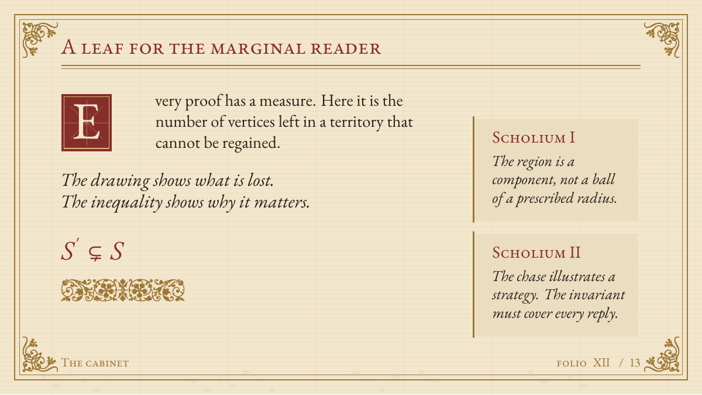 | 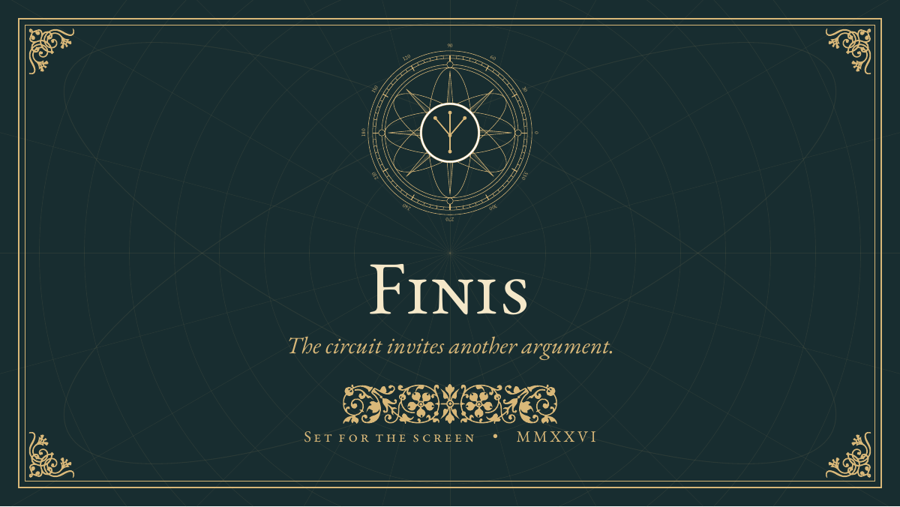 |

For another deck, use the normal Beamer metadata and `\titlepage`, then
ordinary frames, theorems, proofs, lists, and blocks. The grand helpers are:

| Command | Purpose |
|---|---|
| `\AtlasGrandChapter{II}{Title}{Subtitle}` | An unnumbered dark chapter slide |
| `\AtlasGrandScholium{Heading}{Text}` | A marginal note panel; place in a column |
| `\AtlasGrandInitial{A}` | A framed illuminated letter; the specimen shows its placement |
| `\AtlasGrandFleuron[25mm]` | A scalable ornament |
| `\AtlasGrandKicker{Text}` | A small gold heading |
| `\AtlasGrandRubric{Text}` | Spaced small capitals in rubric |
| `\AtlasGrandAstrolabe[55mm]` | The vector instrument, designed for dark frames |

For a custom dark slide, scope the palette around its frame:

```latex
{\AtlasGrandNight
\begin{frame}[plain,noframenumbering]
  \centering
  \AtlasGrandAstrolabe[35mm]\par\bigskip
  {\Huge\scshape Finis\par}
\end{frame}}
```

`[plain]` keeps the ornament but uses black, white, and grays, including on
the chapter slides. Additional theme dependencies are `pgfornament`, TikZ,
`tcolorbox`, and `microtype`. The custom specimen is composed for 16:9 at
11 pt; its plates live in [grand-plates.tex](presentations/grand-plates.tex).
The theme also supports ordinary 4:3 frames. This edition intentionally
tests excess; it does not establish a new requirement for subsequent work.

## The Form of Two — an Euler spectacle

[The second grand specimen](presentations/atlas-euler.tex) explores scale,
depth, and pacing across twelve composed frames (29 presentation pages).
An engraved cube opens on five hinges into a six-square net. A separate
planar drawing then carries the proof: cycle edges disappear, faces merge,
and the remaining tree loses its leaves until only one point remains.
The final formula receives the largest type in the deck.

Bare, unframed pages interrupt the ornament. The tree and point occupy
those quieter pages; the dark astronomical field returns for the equation.
This is a second composition using `AtlasGrand`, not another theme fork.

```sh
./build-beamer.sh --euler                     # atlas-euler.pdf
./build-beamer.sh --euler --handout           # atlas-euler-handout.pdf
./build-beamer.sh --euler --plain             # atlas-euler-plain.pdf
./build-beamer.sh --euler --plain --handout   # atlas-euler-plain-handout.pdf
python3 tools/preview_euler.py                # gallery + nine-plate PDF overview
python3 tools/check_euler.py                  # independent graph/geometry audit
```

Outputs are in `build/beamer/`; the handouts have twelve pages. Advance PDF
pages to unfold the solid and perform individual graph operations. No
special viewer animation support is required. The handout keeps the open
net, final graph states, full reasoning, and the face-erasure count trace.

| The object | The unfolding | The plane |
|:-:|:-:|:-:|
| 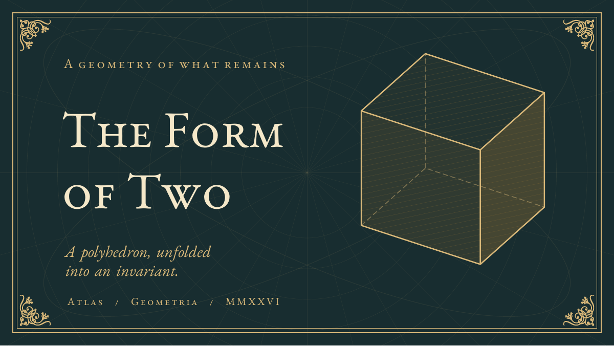 | 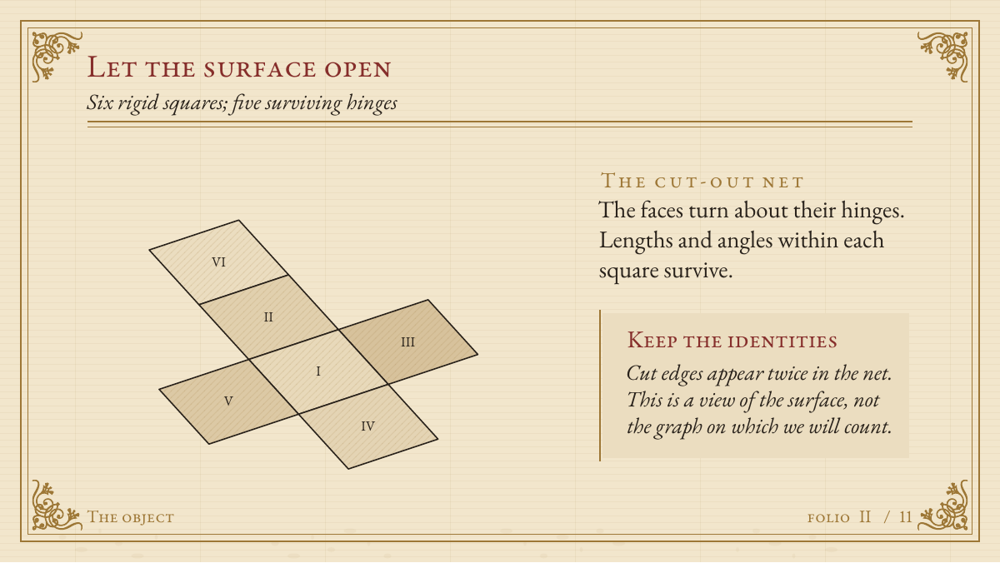 | 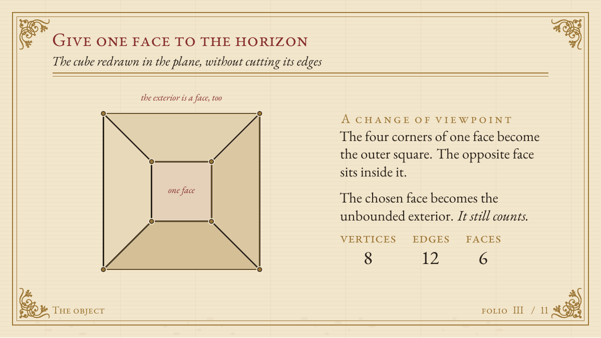 |
| The erasure | The tree | The point |
| 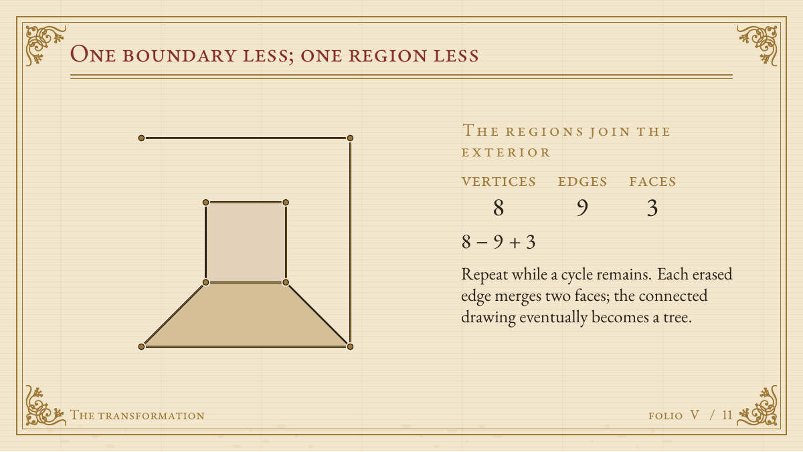 | 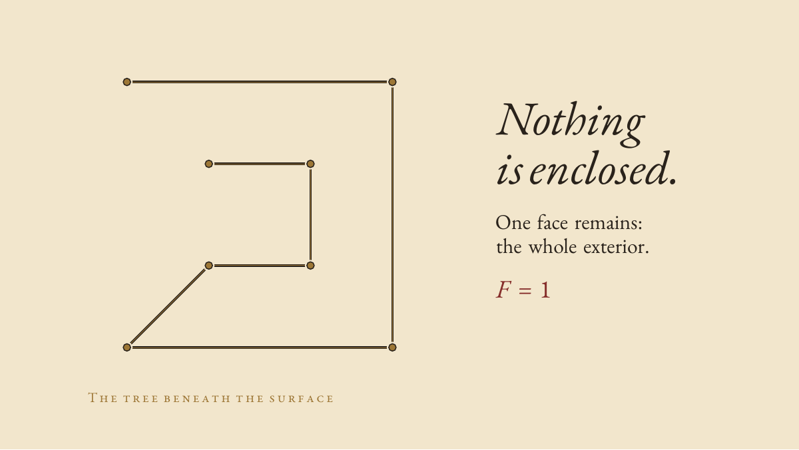 | 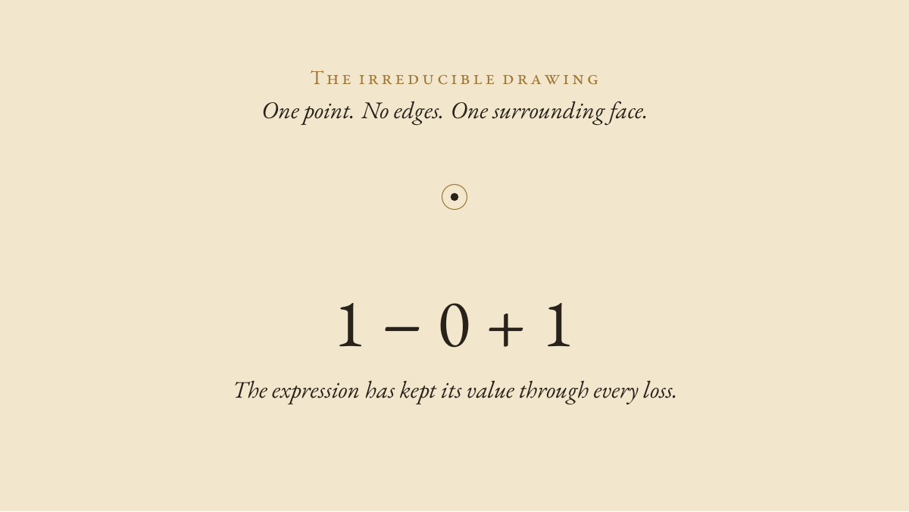 |
| The revelation | Many forms | The theorem |
| 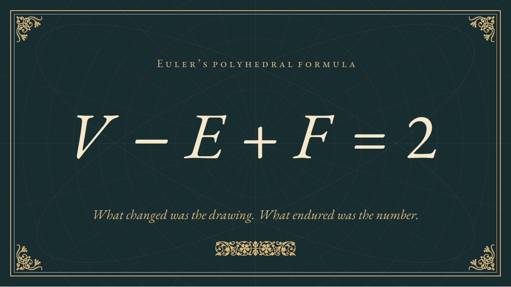 | 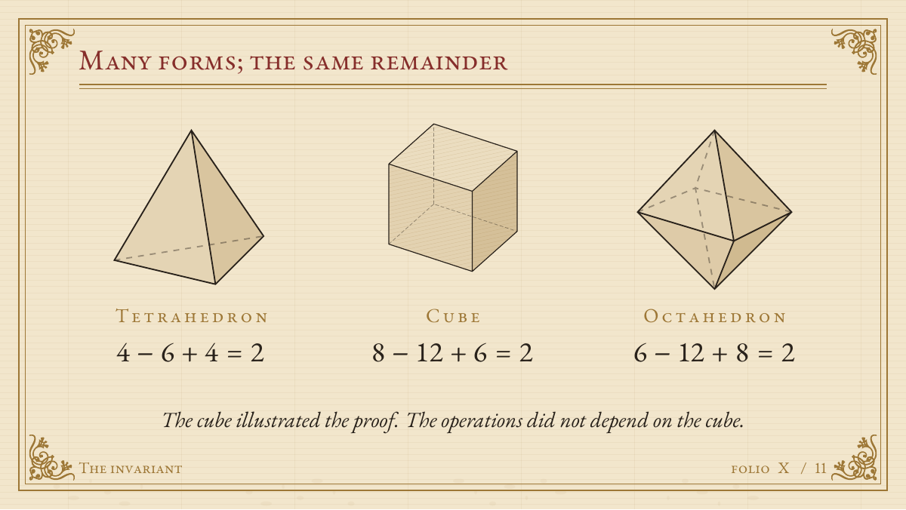 | 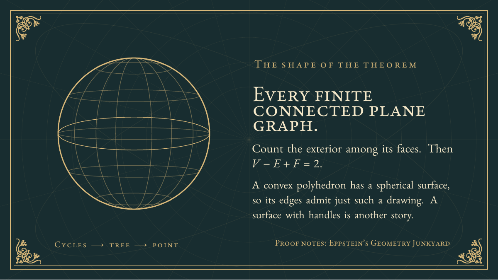 |

The presentation-local helpers live in
[euler-plates.tex](presentations/euler-plates.tex): a quiet page treatment,
scoped dark illustration colors, engraved solids, a fixed graph stage,
and a count ledger. `tools/euler_geometry.py` generates the committed
`euler-folds.tex` from six rigid squares joined by five hinges; regenerate
it only when changing the geometry. Building the deck needs no Python
packages or external image assets.

The net is explicitly a cut surface, where some original edges appear
twice. The proof uses the uncut cube graph in a planar drawing, with the
outer region counted as a face. Its cycle-erasure argument follows
[the induction-on-faces proof collected by David Eppstein](https://ics.uci.edu/~eppstein/junkyard/euler/iface.html),
then prunes the tree to a point. The final claim concerns finite connected
plane graphs, and hence convex polyhedra. It makes no claim that the same
constant applies to surfaces with handles.

## Crawler Chronicles — the first full essay adaptation

[Crawler Chronicles](presentations/crawler-chronicles.tex) adapts Levi
Neuwirth's main essay for an audience arriving without the Git, hosting,
or statistical background. It covers the maintenance discovery, the early
traffic, Anubis, the distributed swarm, the commit-response investigation,
and the correspondence through October 22. The appendix supplies precise
definitions and qualifications; it is not reproduced as another talk.

The result is **34 frames / 37 presentation pages**, with a 34-page handout.
The voice is first person, with comic interludes and the original Court of
Unnecessary Computation petition. All four main-essay graphs appear in full
on white evidence pages. The null-distribution and dominant-cohort panels
also appear as enlarged details. Original graph colors, labels, and data
are preserved, including the scatter's original embedded raster layer.

```sh
./build-beamer.sh --crawler
./build-beamer.sh --crawler --handout
./build-beamer.sh --crawler --plain
./build-beamer.sh --crawler --plain --handout
python3 tools/preview_crawler.py
```

PDFs are named `crawler-chronicles*.pdf` under `build/beamer/`. The overview
is `crawler-chronicles-overview.pdf`. The plain option changes the theme and
emblems to black on white; the original figures and petition retain their
source colors. Beamer `\note{...}` entries in the source carry presenter
context and statistical qualifications.

| Opening | The audience | Anubis |
|:-:|:-:|:-:|
| 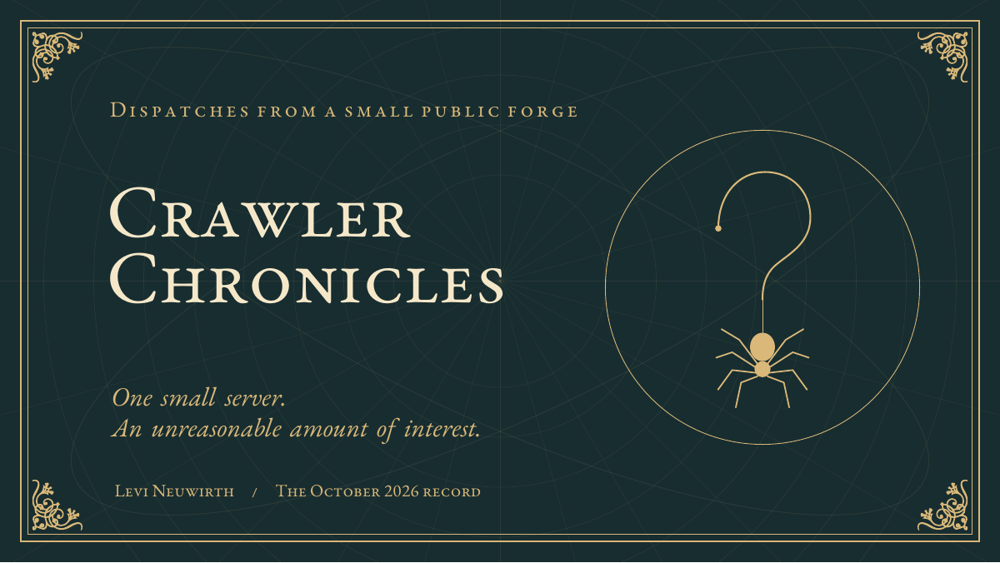 | 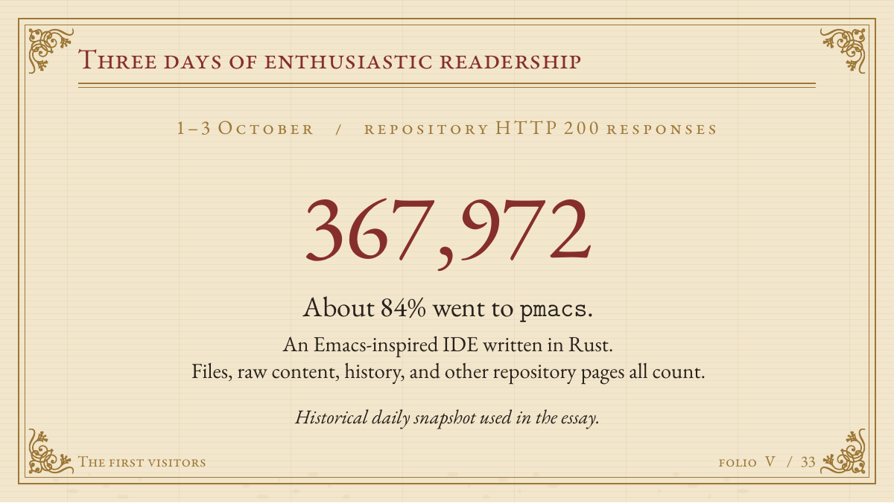 | 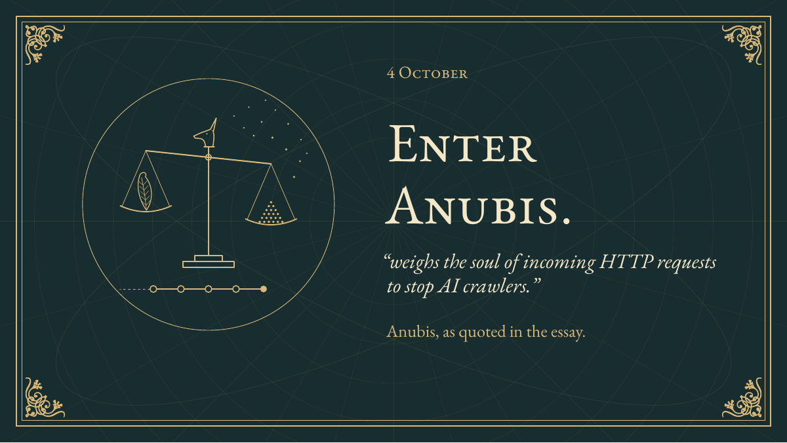 |
| Repository traffic | Publication | The timing comparison |
| 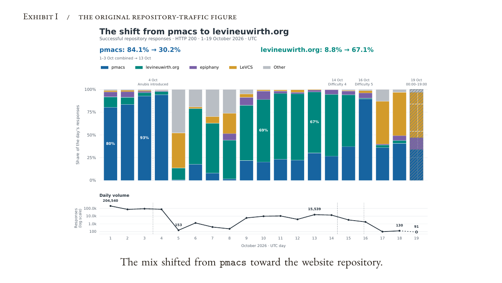 | 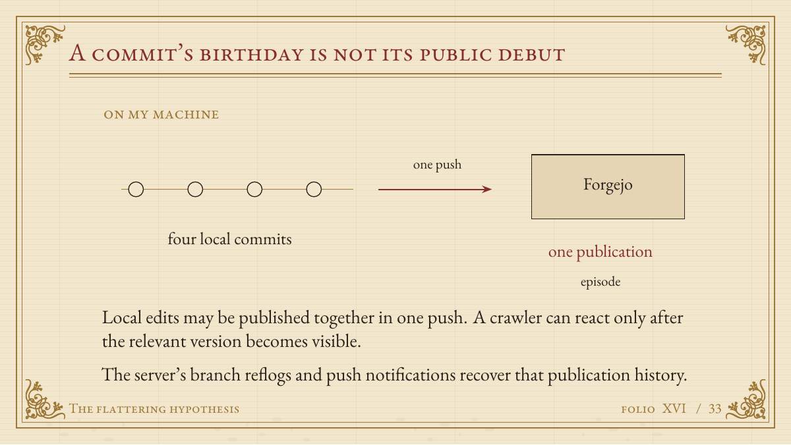 | 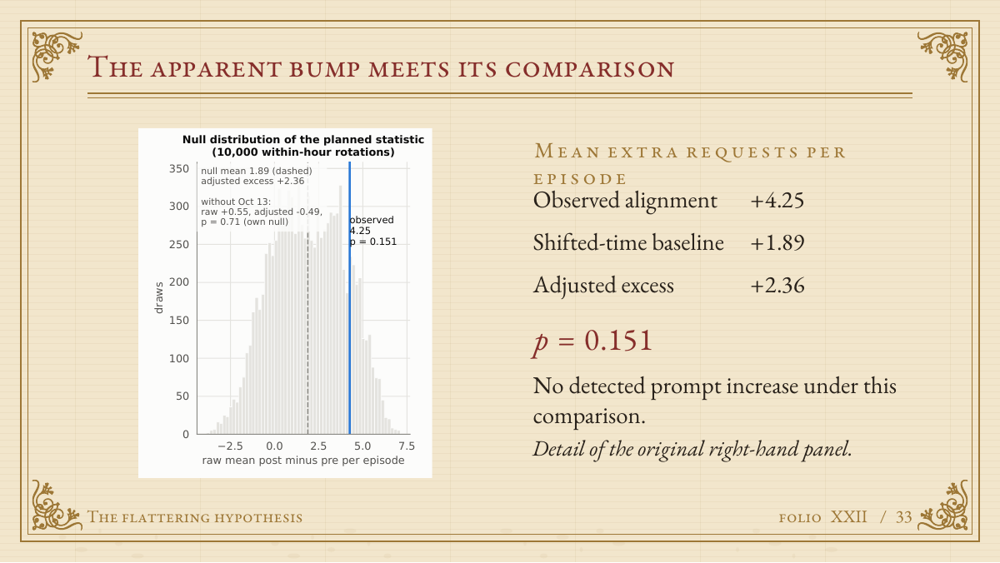 |
| Requested versions | The petition | The takeaway |
| 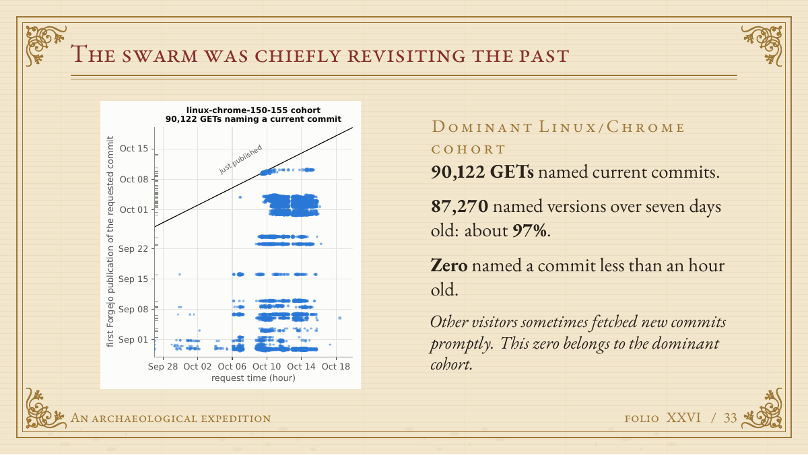 | 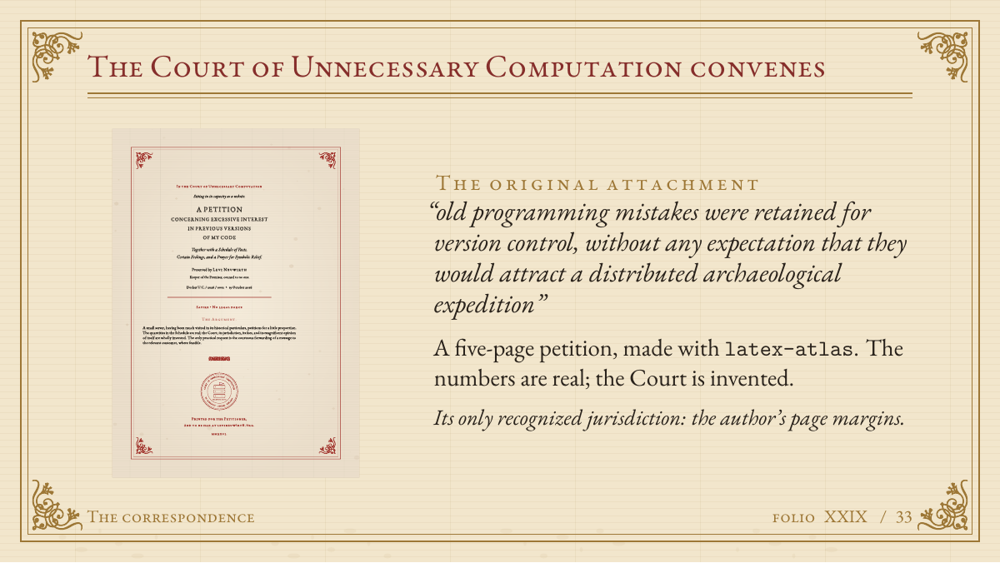 | 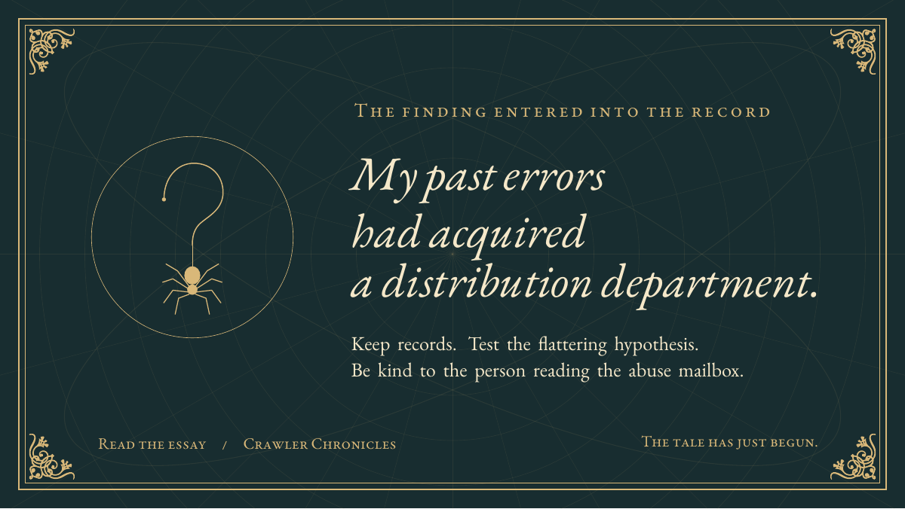 |

The deck builds from frozen assets in `presentations/crawler-assets/`, with
no dependency on the website checkout. `manifest.json` records source paths
and hashes; `adaptation.json` maps all main-essay sections to frames and
records important scope decisions. To refresh deliberately from the website:

```sh
python3 tools/import_crawler.py --source /path/to/content/essays/crawler_chronicles
```

Import requires `rsvg-convert` and `pdftocairo`. The complete original SVGs,
essay, and petition are retained under `originals/`. PDF conversions preserve
their graphics; detail views isolate original panels without redrawing data.
The petition cover is re-emitted as a vector PDF to repair a resource issue
on LuaTeX inclusion; the complete original attachment remains unchanged.

Two main-prose claims are scoped using the appendix: the 48 publication
episodes concern the website repository, and zero sub-hour commit fetches
applies to the dominant Linux/Chrome cohort. The historical daily total of
367,972 differs by one response from the figure's later hourly aggregation;
each original is retained and the difference is documented in the notes.
The figures end on October 19, so the October 22 reply is not presented as
the measured cause of their traffic decline.

The gallery and article/verse documentation below describe the earlier
lab. Its website-preprint plans are historical.

## Gallery

| | | |
|:-:|:-:|:-:|
| [](examples/01-rubricated-incipit.tex) | [](examples/02-marginal-scholia.tex) | [](examples/03-hatched-bar-chart.tex) |
| 01 rubricated incipit | 02 marginal scholia | 03 hatched bar chart |
| [](examples/04-propositions.tex) | [](examples/05-engraved-graph-plate.tex) | [](examples/06-hand-press-impression.tex) |
| 04 propositions | 05 engraved graph plate | 06 hand-press impression |
| [](examples/07-front-matter.tex) | [](examples/08-bibliography.tex) | [](examples/09-verse-page.tex) |
| 07 front matter | 08 bibliography | 09 verse page |

## Examples

| no | file | what it isolates | controls |
|----|------|------------------|----------|
| 01 | `01-rubricated-incipit.tex` | two-colour rubrication: the colour, and each device that carries it | paper, rubric, pilcrow, initial, runhead |
| 02 | `02-marginal-scholia.tex` | the gloss in the margin against the footnote, and the page cut to make room for it | paper, margin, gloss, catchword, folio |
| 03 | `03-hatched-bar-chart.tex` | series by hatch against grey fill; the table of the record; lining figures | paper, hatch, table, lining |
| 04 | `04-propositions.tex` | theorem apparatus after the *Principia* against amsthm; a math font cut for the text against Latin Modern | mathfont, paper, heads, qed, scholium |
| 05 | `05-engraved-graph-plate.tex` | an engraved plate of two graphs: tapered burin strokes, hatched spheres, a matching by line weight, frame and lettering | paper, taper, matching, stipple, frame, lettering |
| 06 | `06-hand-press-impression.tex` | the hand press, counterfeited in a LuaTeX callback: baseline scatter, ink squash, uneven inking, laid paper, foxing | paper, jitter, inkspread, inking, laid, foxing |
| 07 | `07-front-matter.tex` | the leaf before 04: a period title block against `\maketitle`, *The Argument* against the abstract, a Table of the Propositions with their statements against a list of theorems, fleurons, the imprint against the date; the period's ct/st ties against the common ligatures | ligatures, paper, imprint, title, argument, table, fleuron |
| 08 | `08-bibliography.tex` | the last leaf of 04 and 07: the authorities cited by name and year and listed under the name, by a real `.bbx`/`.cbx` written in the plate, against biblatex's numeric default; small-capital family names, old-style figures for the whole leaf, the DOI as text without the URL | oldstyle, paper, names, smallcaps, doi |
| 09 | `09-verse-page.tex` | a page of verse as a book of poems sets one: the block centred on its longest line against the class's indented `verse`, a two-line initial, the title in small capitals, every fifth line numbered, the source set right, a tailpiece; Herbert's *Vertue* (1633) | paper, rubric, numbers, block, title, initial, attribution, tailpiece |

Every control has a *modern default*: what you get from the document
class, the plotting library, or the engine when you do nothing. The
ablation of a marginal gloss is a footnote, of a hatch a grey ramp, of
Q.E.D. a tombstone, of parchment white paper. So each lab variant is a
fair comparison, not a page with a hole in it.

`paper` is a control in every plate. The tints differ slightly per plate
(`F5EDDC`, `F4EBDD`, `F4EAD8`, `F5ECDB`, `F6EFE1`, `F3E9D6`; 07 and 08
take 04's, being the same book): deliberate per-plate tuning, not a
shared token yet. Ablating it across all eight is how that question gets
decided.

## Build

```sh
./build.sh                          # every plate, full treatment, into build/
./build.sh 04-propositions          # a subset
./build.sh --ablate                 # also every lab variant, into build/ablate/
./build.sh -j --ablate              # the same, one job per core (-j4 for four)
./preview.sh                        # PNGs into preview/ and preview/ablate/
./gallery.sh                        # regenerate the lab gallery in this README
```

One `lualatex` run per PDF is the rule. A plate that needs more declares
it in its header, next to `%!TEX program`, and every variant inherits the
declaration:

```latex
%!ATLAS passes=3
%!ATLAS biber
```

`passes=N` runs `lualatex` N times under the same jobname; `biber` runs
biber after the first pass, on the `.bcf` in the output directory. 08 is
the plate that needs both.

Requirements: LuaLaTeX (TeX Live 2026), `fontspec`, `unicode-math`,
`amsthm`, `geometry`, `microtype`, `xcolor`, `tikz` (+ `calc`,
`patterns.meta`), `pgfornament`, `fancyhdr`, `lettrine`, `needspace`, `luacode`,
`biblatex` with `biber`.
EB Garamond and Garamond-Math if present (`texlive-fontsextra`), else
TeX Gyre Pagella and Pagella Math; the committed previews are the
Garamond renderings. Previews need poppler's `pdftoppm`; they are
byte-reproducible from a clean build, so a rebuild leaves the tree clean.

## The lab

Each plate carries this block after `\documentclass`, identical in every
file so that the files stay standalone:

```latex
\atlascontrol{<name>}{<treatment>}{<modern default>}
```

The treatment is set unless `<name>` appears in `\atlasomit`, a comma
list that `build.sh --ablate` passes on the `lualatex` command line, so no
file is edited to produce a variant. For each plate the lab compiles one
variant per control with that control at its modern default, and one
`--plain` variant with all of them. `\atlasstamp`, at the foot of every
plate, prints the controls and which of them the impression has set to
the default, so each PNG below names itself.

To add a plate: copy the lab block, wrap each device you want to test in
`\atlascontrol` with an honest modern default in the third argument, end
the plate with `\atlasstamp`, and run the three scripts. `build.sh` finds
the controls by grepping for `\atlascontrol{name}`, so a name is
lower-case letters, digits and hyphens. A plate must stay one file: what
it needs beyond the TeX distribution it writes itself, as 08 writes its
`.bib`, `.bbx` and `.cbx` in `filecontents*` blocks under `\jobname`.

<!-- lab:begin -->

### 01 rubricated incipit

| | | | |
|:-:|:-:|:-:|:-:|
| [](examples/01-rubricated-incipit.tex) |  |  |  |
| full | without paper | without rubric | without pilcrow |

| | | | |
|:-:|:-:|:-:|:-:|
|  |  |  | |
| without initial | without runhead | plain | |

### 02 marginal scholia

| | | | |
|:-:|:-:|:-:|:-:|
| [](examples/02-marginal-scholia.tex) |  |  |  |
| full | without paper | without margin | without gloss |

| | | | |
|:-:|:-:|:-:|:-:|
|  |  |  | |
| without catchword | without folio | plain | |

### 03 hatched bar chart

| | | | |
|:-:|:-:|:-:|:-:|
| [](examples/03-hatched-bar-chart.tex) |  |  |  |
| full | without paper | without hatch | without table |

| | | | |
|:-:|:-:|:-:|:-:|
|  |  | | |
| without lining | plain | | |

### 04 propositions

| | | | |
|:-:|:-:|:-:|:-:|
| [](examples/04-propositions.tex) |  |  |  |
| full | without mathfont | without paper | without heads |

| | | | |
|:-:|:-:|:-:|:-:|
|  |  |  | |
| without qed | without scholium | plain | |

### 05 engraved graph plate

| | | | |
|:-:|:-:|:-:|:-:|
| [](examples/05-engraved-graph-plate.tex) |  |  |  |
| full | without paper | without taper | without matching |

| | | | |
|:-:|:-:|:-:|:-:|
|  |  |  |  |
| without stipple | without frame | without lettering | plain |

### 06 hand press impression

| | | | |
|:-:|:-:|:-:|:-:|
| [](examples/06-hand-press-impression.tex) |  |  |  |
| full | without paper | without jitter | without inkspread |

| | | | |
|:-:|:-:|:-:|:-:|
|  |  |  |  |
| without inking | without laid | without foxing | plain |

### 07 front matter

| | | | |
|:-:|:-:|:-:|:-:|
| [](examples/07-front-matter.tex) |  |  |  |
| full | without ligatures | without paper | without imprint |

| | | | |
|:-:|:-:|:-:|:-:|
|  |  |  |  |
| without title | without argument | without table | without fleuron |

| | | | |
|:-:|:-:|:-:|:-:|
|  | | | |
| plain | | | |

### 08 bibliography

| | | | |
|:-:|:-:|:-:|:-:|
| [](examples/08-bibliography.tex) |  |  |  |
| full | without oldstyle | without paper | without names |

| | | | |
|:-:|:-:|:-:|:-:|
|  |  |  | |
| without smallcaps | without doi | plain | |

### 09 verse page

| | | | |
|:-:|:-:|:-:|:-:|
| [](examples/09-verse-page.tex) |  |  |  |
| full | without paper | without rubric | without numbers |

| | | | |
|:-:|:-:|:-:|:-:|
|  |  |  |  |
| without block | without title | without initial | without attribution |

| | | | |
|:-:|:-:|:-:|:-:|
|  |  | | |
| without tailpiece | plain | | |

<!-- lab:end -->

## The style

`sty/atlas.sty` is the graduation: the treatments plates 04, 07 and 08
share, plus what a whole document needs and a single plate never shows
(a title leaf printed once, running heads, folios). It dresses an
existing `article` or `amsart` manuscript without editing its body: load
it last in the preamble and name the manuscript's theorem environments
to the apparatus —

```latex
\usepackage{atlas}                      % or [plain] for white paper
\AtlasProposition{theorem}{Theorem}[theorem]
\AtlasProposition{lemma}{Lemma}[theorem]
\AtlasDefinition{definition}{Definition}[theorem]
\AtlasScholium{remark}{Remark}[theorem]   % or Scholium, if the prose allows
\AtlasSplitTitle   % only if the title's \\ introduces a subtitle
```

— then `TEXINPUTS=path/to/latex-atlas/sty: lualatex` twice, or as
often as the original needs (a hyperref `.out` can take three). The bracket
names the counter the environment steps. A manuscript's `[T1]{fontenc}`,
`lmodern` and `amssymb` lines come out (unicode-math has the symbols;
`mathtools` may stay). The header of the file says what it sets;
`HANDOFF.md` records what dressing four real preprints taught it — seven
things from a 12-page paper, nine more from a 35-page one, nine more
from a 21- and a 19-page pair (cleveref, a subtitle after `\\`,
six-name author compounds, file names in typewriter).

On call, `\AtlasTable` prints a Table of the Propositions with real page
numbers from the `.aux` (two passes) and `\AtlasColophon` a colophon leaf
naming faces, engine, sources and revision.

`sty/atlas-grand.sty` is the other register: load it in place of `atlas`
and every costume device the lab has goes on at once — rubric, glossed
margin, initials, framed title leaf with the Table, fleurons, the hand
press and its foxed laid paper, an ornamented colophon. Three passes. It
is there to find the limit, not to post.

`sty/atlas-verse.sty` is verse over either: `\begin{poem}…\end{poem}` with
every line ending in `\\`, a `poem*` for shaped verse, `\poemtitle`,
`\attribution`, `\tailpiece`, a Contents and a sorted Index of First
Lines from the `.aux`, initials and numbers on under `atlas-grand`. A
poem measures its own lines — the widest is the block, the first is its
Index entry — and warns when a stanza runs over. `tools/verse.py` turns
plain text (`# Title`, blank lines between stanzas, indentation by spaces,
`@ attribution`, `---` for a tailpiece) into a book ready to build.
`bound/temple.tex` is its proof: four poems of Herbert's *The Temple*
(1633) as a seven-leaf chapbook — see its header for the command; three
passes. A poem may break across leaves; a block whose lines run over, or
that is wider than the measure, is warned of. The author's own
poems are dressed the way the manuscripts are: on a copy in scratch,
output to `build/`, nothing committed.

`bound/treatise.tex` gathers 07, 04 and 08 into one PDF with pdfpages,
as printed: the proof that made the seams visible and the style
necessary.

## Earlier direction: website preprints (superseded)

The style above is the path. When a treatment proves itself in the lab,
it moves into `sty/atlas.sty`; preprints for `levineuwirth.org` (sources
in `~/Repos/research/meyniel`, export via `make export`) are dressed by
loading it, on a copy, with their bodies untouched. What the lab has
graduated so far: the gloss's page geometry, the apparatus of 04, the
front matter of 07, the head and measure of 08, the monochrome discipline
of 03 and 05. The frame, the lettering, 07's fleurons and imprint, and
everything in 06 are costume, and stay here. No vault (`~/universum`)
material enters this repo, and no manuscript text does either.

## License

CC BY-SA 4.0, see `LICENSE`. Third-party deps (e.g. `fiziko` if later
examples use it) are not relicensed here.
