<!-- SPDX-License-Identifier: MIT -->
<!-- Copyright (c) 2026 the repository contributors -->

# Presentation guide

[Back to Atlas](../README.md). Commands below run from the repository root.

## Start a talk

The repository's `atlas` command creates, builds, previews, and checks a talk.
It uses Python 3.9+ (standard library only), LuaLaTeX, `latexmk`, and Poppler.
Preview contact sheets also use pdfLaTeX and `pdfpages`. Install the theme's
TeX packages and fonts listed below; missing fonts can use the theme's fallbacks.

```sh
./atlas new /path/to/my-talk
# Edit /path/to/my-talk/talk.tex; put figures in its assets/ directory.
./atlas build /path/to/my-talk/talk.tex
./atlas preview /path/to/my-talk/talk.tex
./atlas check /path/to/my-talk/talk.tex --all-variants
```

`new` refuses to overwrite an existing directory. The generated talk stays
independent of the specimen assets, but uses the themes from this checkout.
A bare name typed at the root of the checkout, `./atlas new keynote`, makes
`talks/keynote/`: the repository ignores `talks/`, so personal talks stay out
of its history.
Invoke `atlas` by its absolute path from elsewhere, or symlink it into a
directory on your `PATH`; the symlink still locates the original theme files.

Builds resolve figure and `\input` paths relative to the deck directory.
`latexmk` reruns LuaLaTeX as needed to settle references and recorded positions,
and reuses current outputs on subsequent builds. `--plain` and `--handout`
are independent options; `--notes` adds [speaker notes](#speaker-notes).
For `my-talk/keynote.tex`, outputs are:

```text
my-talk/
  keynote.tex
  assets/
  build/keynote/
    keynote.pdf               a copy to send, named after the deck
    keynote-handout.pdf       likewise for each variant built
    ornate/talk.pdf           each variant's own build directory
    ornate-handout/talk.pdf
    plain/talk.pdf
    plain-handout/talk.pdf
```

Each variant keeps its own auxiliary files and `build.stdout.txt` under a
fixed name, `talk.pdf`, for tools; the named copy beside them is refreshed by
every successful build. Use `--output-dir DIR` to change the build root.

A deck whose paths assume another working directory, say the repository
root, declares it in a comment near its top, relative to the deck:

```tex
%!TEX program = lualatex
% atlas: workdir=../..
```

`--workdir DIR` on the command line overrides it. The specimens in
`presentations/` declare `workdir=..`, so `./atlas build
presentations/atlas-grand.tex` needs no options. The same comment can set
`min-text=` for [text sizes](#text-sizes); quote values containing spaces.

The existing `build-beamer.sh` commands remain available with their original
output locations.

`preview` builds a `.tex` deck, or reads an existing `.pdf`. It produces
1200-pixel page PNGs and a vector `overview.pdf`, up to nine slides per sheet,
in `talk-preview/` beside the PDF. By default it includes every PDF page,
including overlays. To select particular pages or unique text:

```sh
./atlas preview /path/to/my-talk/talk.tex --handout
./atlas preview /path/to/talk.pdf --pages 1,3-7
./atlas preview /path/to/talk.pdf --match 'The full comparison' --match 'Give the evidence room.'
```

Text selections must match exactly one page; use page numbers for repeated
overlay titles. The preview manifest records the source and selected pages.

`check` forces a rebuild, reports LaTeX warnings, overfull/underfull boxes,
missing glyphs, remaining `\AtlasTodo` markers, extracted text within one
point of or beyond a page edge, and [text too small to read](#text-sizes).
It writes `check.json` beside each checked PDF. Exit status is zero only when
the build succeeds and no findings remain; findings and operational errors
return nonzero. `--all-variants` checks all four combinations. These bounds
are a review aid: they cannot detect every clipped graphic, overlapping
element, or visual imbalance. Inspect the previews too.

### Text sizes

A figure that reads well on a laptop can be unreadable from the back of a
room once it is scaled into a column. `check` measures every run of text as
it is drawn, after `\resizebox`, TikZ scaling, and inside included PDF
figures, and reports any page with text below 6 pt. Sizes are projected:
measured against a 16:9 Beamer page, 90 mm high, so a 4:3 page is judged at
the same height on screen. Beamer's `\tiny` is 6 pt; the Atlas footer is 8.

```text
Page 16: 68 text runs below 6 pt as projected (smallest 3.0 pt): '00:00–19:00', '130', '14 Oct'
```

Raise or lower the floor with `--min-text PT`, or for one deck with
`% atlas: min-text=PT`; the command line wins. Some small text is not meant
to be read: a document shown as an object, an engraved scale. Declare it in
the frame, with the reason, and `check` lists that page as declared instead
of failing:

```tex
\begin{frame}{The petition}
  \AtlasFinePrint{the first page is shown as a facsimile}
  ...
```

The declaration covers the whole page. The Grand astrolabe declares its own
degree scale. Text that leaves no ink is not counted: labels a clip removes,
as when `\includegraphics[trim=…,clip]` crops a figure, or text hidden
under an image. `check` finds these by rendering a failing page with and
without its text, which needs Ghostscript (`gs`); without it, hidden text
is reported too. Lettering inside raster images is not text and is not
measured. Scripts are measured on their handout pages, which match theirs
one for one; presenter builds are not measured, since their slides are the
ordinary build's.

### Emblems and photographs

Two commands prepare assets the way the themes expect them.

```sh
./atlas emblem mark.svg --out-dir talks/keynote/assets
./atlas photo ~/Pictures/IMG_4127.HEIC ~/Pictures/IMG_4130.jpg --out-dir talks/keynote/assets/photos
```

`emblem` turns a one-colour SVG into `mark-gold.pdf`, `mark-ink.pdf`, and
`mark-plain.pdf`, the files `\AtlasEmblem{assets/mark}{gold}{30mm}` selects.
It recolours `currentColor`; for artwork drawn in a fixed colour, name it
with `--replace '#000000'` (or `--replace black`, as the file writes it).
Only colour values change, in `fill`, `stroke`, and the other colour
attributes and CSS properties; class names, ids, and text that happen to
read `black` are left alone. `--name` sets the output stem. It needs
`rsvg-convert` (librsvg).

`photo` writes each image as an upright JPEG no larger than 2400 pixels
(`--size`), with location and camera metadata and comments removed and its
colour profile kept. LuaLaTeX ignores a phone's rotation flag and embeds the file
as given, metadata included, in every PDF you send. Originals are never
replaced, nor existing outputs without `--force`. It needs ImageMagick; HEIC
input needs ImageMagick built with HEIF support.

### Speaker notes

Write notes as ordinary Beamer `\note{...}` inside a frame. `--notes` builds
them in either of two forms, beside the other variants:

```sh
./atlas build talk.tex --notes script      # build/talk/ornate-script/talk.pdf
./atlas build talk.tex --notes presenter   # build/talk/ornate-presenter/talk.pdf
pdfpc --notes=right build/talk/ornate-presenter/talk.pdf
```

- **script** is for rehearsal and for print: one page per frame, in order,
  including frames without notes ("No notes for this slide"). Each page
  shows the folio the audience sees, the frame title, the notes, and the
  frame itself, taken from the handout, which `atlas` builds first. The
  script and handout must have the same number of pages, or the build stops.
- **presenter** is for giving the talk: every slide, with its notes beside it
  on a double-width page. A presenter console such as
  [pdfpc](https://pdfpc.github.io/) shows the left half to the room and the
  right half to you. The notes use the whole half page, in larger type.

Notes are set in the largest of four sizes that fits. A note too long even
at the smallest size is reported by `atlas check --notes ...`, naming the
slide, rather than clipped. References in notes resolve as on the slides.
`--notes` combines with `--plain`; a script already collapses overlays, so it
does not take `--handout`. Check notes separately from `--all-variants`.

Without the CLI, `\usetheme[notes=script]{AtlasGrand}` (or `presenter`) does
the same; add the `handout` class option for a script. Its thumbnails are
then Beamer's own, which cannot place slide content positioned with TikZ
`remember picture` overlays; the CLI's handout pages can.

Run the CLI regression checks with:

```sh
python3 -m unittest discover -s tools -p 'test_*.py'
```

### Continuous integration

[GitHub Actions](https://github.com/levineuwirth/latex-atlas/actions/workflows/ci.yml)
runs on pushes to `main`, pull requests, and manual dispatch. The fast jobs
test Python 3.9 and 3.14, verify the frozen Crawler source hashes, and audit
the Euler geometry. A separate Ubuntu 24.04 job installs TeX and runs real
presentation checks:

- A newly created talk outside the checkout, in all four variants.
- A deck with relative figure and TeX includes, spaces in filenames, and a
  forward reference.
- Atlas, Grand, Euler, and Crawler specimens, with expected page counts.
- A selected-slide preview and the full Crawler overview across five sheets.

The `presentation-checks` artifact contains PDFs, PNGs, reports, and build
logs for seven days, including diagnostics from failed runs. Builds use
only committed assets; the website checkout is not required. Page counts
are intentional regression expectations in `tools/ci_smoke.py`; update
them alongside intentional slide or overlay changes.

To run the integration checks locally with TeX and Poppler installed:

```sh
python3 tools/ci_smoke.py
```

Outputs go to the ignored `build/ci/` directory. Automated checks cover
compilation and text bounds; the artifacts still need a visual review
when the design changes.
CI also [builds and checks the release bundle](releases.md) and uploads it
as a separate `release-candidate` artifact.

### The starter source

Copy [presentations/starter.tex](../presentations/starter.tex). It is a single
editable file with six patterns: a dark opening, ordinary content with
overlays, a full-page figure, an enlarged detail, a quiet italic quotation,
and a closing takeaway. The illustrative chart is drawn inside the file;
there are no dependencies on the specimen decks or website assets.

```sh
./build-beamer.sh --starter                  # build/beamer/atlas-starter.pdf
./build-beamer.sh --starter --handout        # six pages; overlays collapsed
./build-beamer.sh --starter --plain          # black-on-white theme
./build-beamer.sh --starter --plain --handout
python3 tools/preview_starter.py              # six-pattern overview and gallery
```

The presentation has six frames and seven pages because the ordinary
content slide reveals two items. Edit the metadata at the top, then the
six marked sections. Replace `\TalkFigure` and `\TalkDetail` with your own
PDF/image inclusions; the comments give size limits and examples. Keep the
axes and legends needed to interpret a detail. Quiet-page and dark-palette
changes are scoped to their frames; the full figure and quiet quotation use
the [slide kit](#the-grand-edition). Speaker notes use ordinary `\note{...}`;
see [Speaker notes](#speaker-notes) to build a script or presenter view.

For a copied file outside the repository, compile with LuaLaTeX three times,
with the repository's `sty/` directory on the TeX search path:

```sh
TEXINPUTS=/path/to/latex-atlas/sty: lualatex talk.tex
TEXINPUTS=/path/to/latex-atlas/sty: lualatex talk.tex
TEXINPUTS=/path/to/latex-atlas/sty: lualatex talk.tex
```

| Opening | Ordinary content | Full figure |
|:-:|:-:|:-:|
| 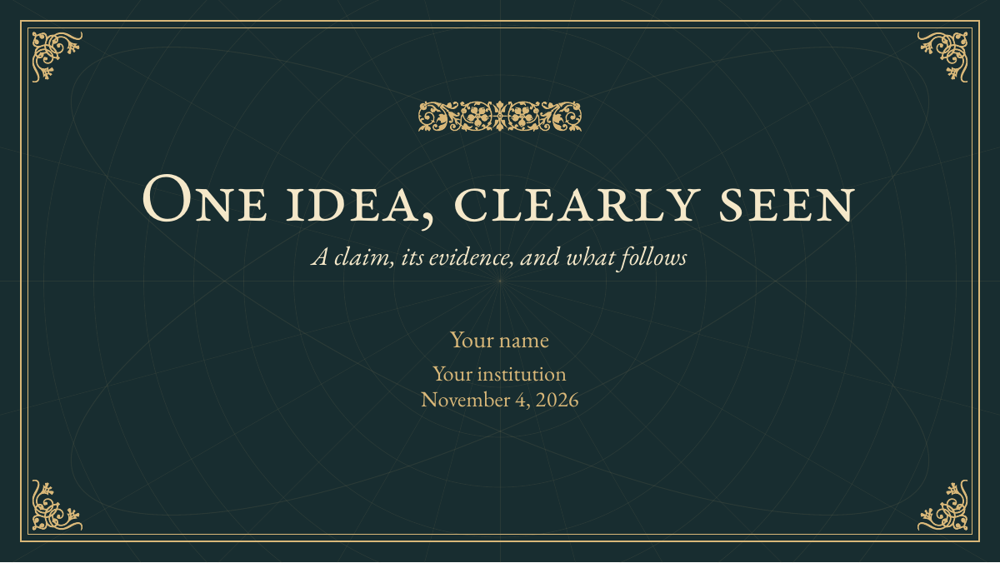 | 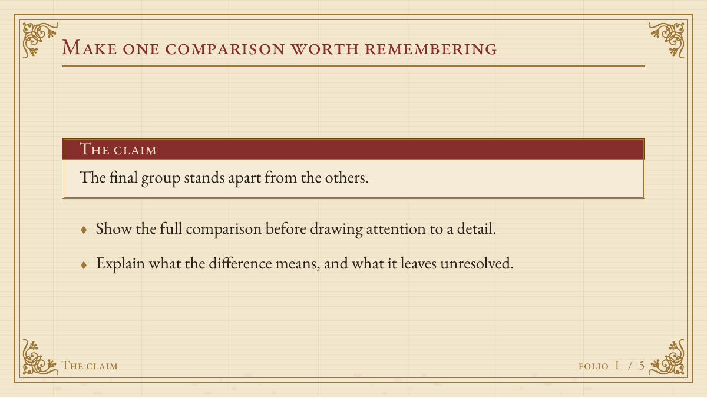 | 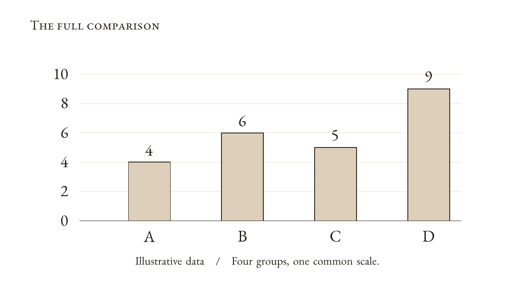 |
| Detail | Quiet quotation | Closing |
| 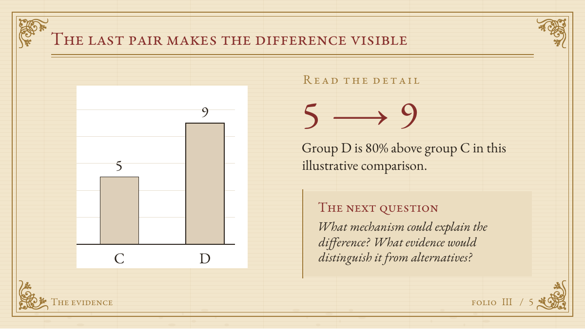 | 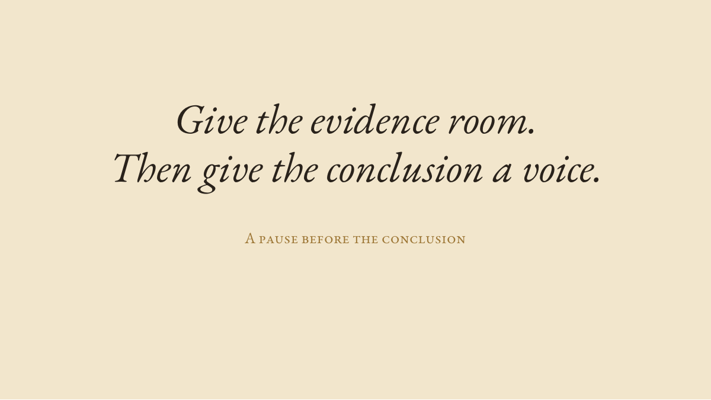 | 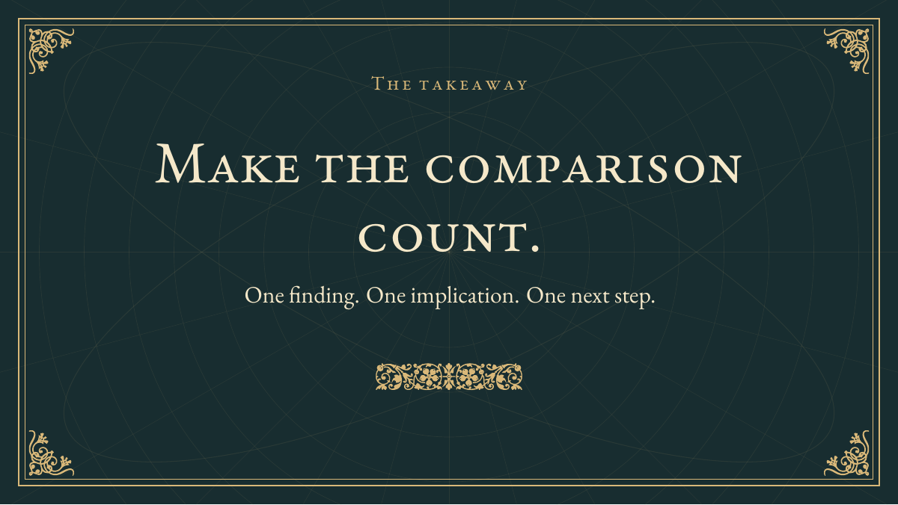 |

## Beamer

```latex
\documentclass[aspectratio=169,12pt]{beamer}
\usetheme{Atlas}
\title{A presentation}
\author{Your name}
\date{}
\begin{document}
\begin{frame}[plain,noframenumbering]
  \titlepage
\end{frame}
\begin{frame}{An observation}
  Ordinary Beamer content, including math, blocks, and overlays.
\end{frame}
\end{document}
```

Compile with **LuaLaTeX**, with `sty/` on `TEXINPUTS`, twice to resolve
references and the frame count. The theme is `sty/beamerthemeAtlas.sty`;
load it with `\usetheme{Atlas}`. It is independent of the article packages
`atlas` and `atlas-grand`; do not load those in a presentation.

Build [the specimen deck](../presentations/atlas.tex) from the repository:

```sh
./build-beamer.sh                     # build/beamer/atlas.pdf
./build-beamer.sh --plain             # atlas-plain.pdf: black on white
./build-beamer.sh --handout           # atlas-handout.pdf: collapsed overlays
./build-beamer.sh --plain --handout   # atlas-plain-handout.pdf
```

For your own deck, point to this repository's `sty/` directory:

```sh
TEXINPUTS=/path/to/latex-atlas/sty: lualatex talk.tex
TEXINPUTS=/path/to/latex-atlas/sty: lualatex talk.tex
```

The first version styles the title page, frame titles and subtitles,
numbered theorems, proofs, lists, blocks, and frame numbers. Beamer keeps
control of sections, references, overlays, and page size. The specimen
uses 16:9 at 12 pt; those are document options, not theme requirements.
The title frame above is unnumbered, and overlays share a frame number.

The specimen now includes an argument in motion: a large theorem statement,
a six-step cop-and-robber chase on a fixed tree, and a diagram beside a
three-step proof. Advance PDF pages to move through the overlays; these are
speaker-paced steps, with no timer or special PDF animation support needed.
The cop and robber have distinct lettered pieces, while halos and dashed
branches show the shrinking region. The handout keeps an intermediate
position and a table of the complete chase, followed by the full proof.
These slide patterns live in [presentations/tree-pursuit.tex](../presentations/tree-pursuit.tex)
and use ordinary Beamer and TikZ commands, independently of the theme.

Use `\usetheme[plain]{Atlas}` for black on white and the Beamer class's
`handout` option to collapse overlays. These are independent choices.
Customize individual elements with normal `\setbeamercolor`,
`\setbeamerfont`, and `\setbeamertemplate` calls after loading the theme.
The named colors are `AtlasPaper`, `AtlasInk`, and `AtlasRubric`.

Requirements: LuaLaTeX, Beamer, `fontspec`, `unicode-math`, EB Garamond
and Garamond-Math (with TeX Gyre Pagella and Pagella Math as fallbacks).
The specimen also uses TikZ and `booktabs`. This is an initial theme for
visual exploration; projection readability still needs an actual room.

## The grand edition

`\usetheme{AtlasGrand}` is the maximalist investigation: gilded double
borders and corner ornaments, laid and chain lines, illuminated initials,
framed theorem blocks, marginal scholia, Roman folios, and dark astronomical
chapter openings. It loads the Beamer `Atlas` theme, not the old article
package `atlas-grand`.

[The grand specimen](../presentations/atlas-grand.tex) expands the argument
into an engraved mathematical atlas. Its illustrations include an armillary
frontispiece, medallion player pieces, a seven-segment countdown dial,
hatched territory bars, and animated one- and two-cop cycle plates.
Everything is vector; the overlays advance with the speaker. The handout
keeps a single coherent position and the whole argument on each frame.

```sh
./build-beamer.sh --grand                     # atlas-grand.pdf
./build-beamer.sh --grand --handout           # atlas-grand-handout.pdf
./build-beamer.sh --grand --plain             # atlas-grand-plain.pdf
./build-beamer.sh --grand --plain --handout   # atlas-grand-plain-handout.pdf
python3 tools/preview_grand.py                # gallery + vector PDF overview
```

All PDFs are in `build/beamer/`. Grand builds take three LuaLaTeX passes
to settle the positions of the page ornaments. The preview command makes
`atlas-grand-overview.pdf`, a nine-plate contact sheet, and the gallery
below. It requires Poppler and pdfLaTeX (the latter only combines existing
PDF pages). Preview selections follow text in the deck, rather than fixed
page numbers.

| Frontispiece | Chapter opening | Proposition |
|:-:|:-:|:-:|
| 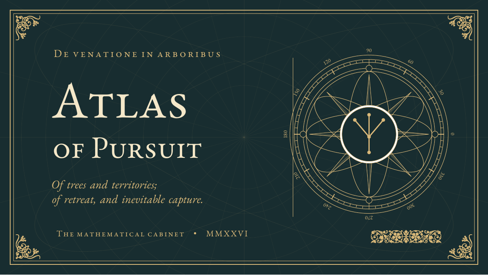 | 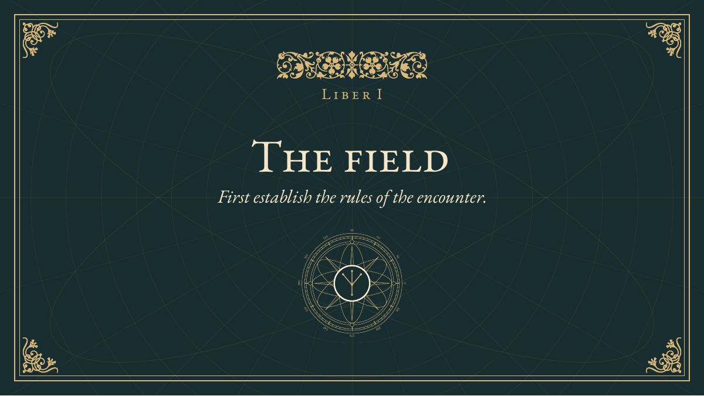 | 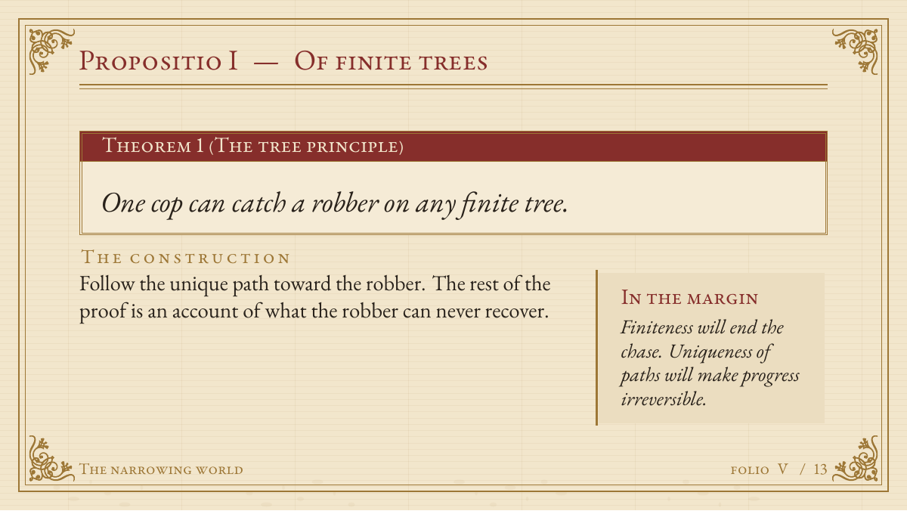 |
| Chase | Working proof | Hatched chart |
| 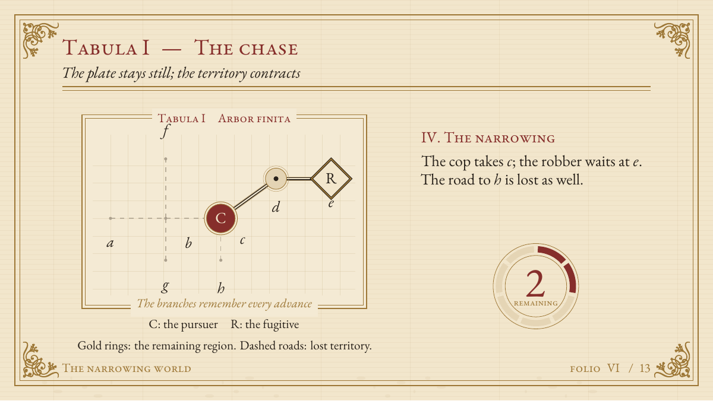 | 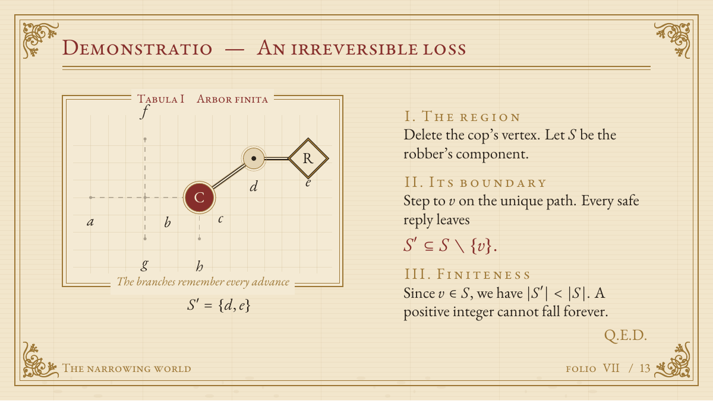 | 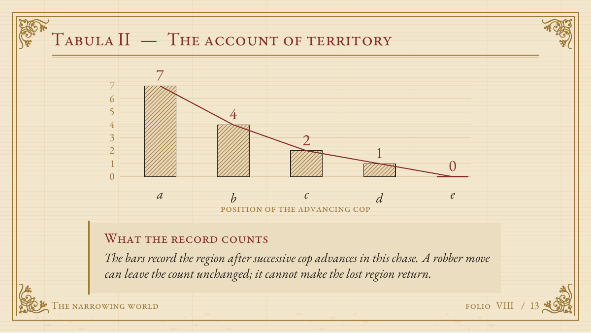 |
| Two boundaries | Marginalia | Finis |
| 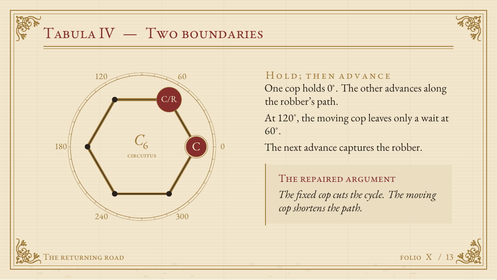 | 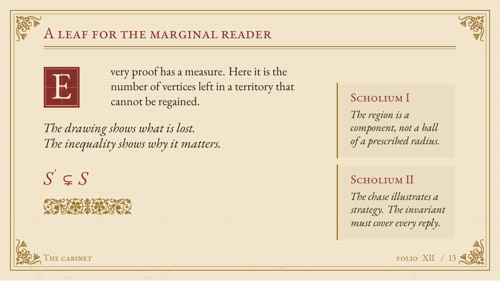 | 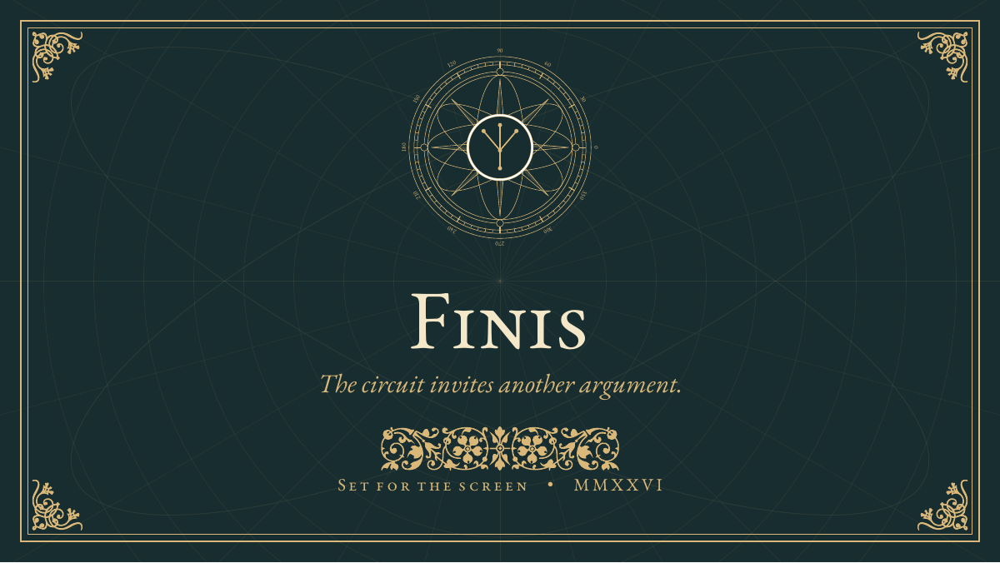 |

For another deck, use the normal Beamer metadata and `\titlepage`, then
ordinary frames, theorems, proofs, lists, and blocks. The grand helpers are:

| Command | Purpose |
|---|---|
| `\AtlasGrandChapter{II}{Title}{Subtitle}` | An unnumbered dark chapter slide |
| `\AtlasGrandScholium{Heading}{Text}` | A marginal note panel; place in a column |
| `\AtlasGrandInitial{A}` | A framed illuminated letter; the specimen shows its placement |
| `\AtlasGrandFleuron[25mm]` | A scalable ornament |
| `\AtlasGrandKicker{Text}` | A small gold heading |
| `\AtlasGrandRubric{Text}` | Spaced small capitals in rubric |
| `\AtlasGrandAstrolabe[55mm]` | The vector instrument, designed for dark frames |

The slide kit collects patterns that real talks kept rebuilding. Use them
inside ordinary frames, so notes and overlays work as usual:

| Command | Purpose |
|---|---|
| `\AtlasGrandQuiet`, `\AtlasGrandWhite` | Page switches like `\AtlasGrandNight`: plain paper or white, no border or footer |
| `\AtlasGrandStatement{Kicker}{Sentence}{Support}` | One sentence given the whole slide; use on a quiet or night page |
| `\AtlasGrandStat{367,972}{requests in three days}` | A large figure with its label |
| `\AtlasGrandAside{Text}` | A small italic qualification |
| `\AtlasGrandExhibit{Label}{Content}{Caption}` | A full-page figure or photograph with label and caption |
| `\AtlasGrandPhoto{file}{width}{height}` | A photograph in a gilt double rule, scaled to fit without distortion |
| `\AtlasTodo{Text}` | A visible unfinished-passage marker (both themes) |
| `\AtlasEmblem{stem}{palette}{height}` | Includes `stem-palette.pdf`, or `stem-plain.pdf` under `[plain]` (both themes) |

```latex
{\AtlasGrandQuiet
\begin{frame}[plain]
  \AtlasGrandStatement{The finding}{My latest work could wait.}
    {Almost everything requested was over a week old.}
  \note{The qualification belongs here, not on the slide.}
\end{frame}}

{\AtlasGrandNight
\begin{frame}[plain]
  \AtlasGrandExhibit{The site}{\AtlasGrandPhoto{assets/site.jpg}{130mm}{54mm}}
    {A caption, or leave it empty.}
\end{frame}}
```

Each photograph slide is one frame, so adding another later is a copy of
those four lines. On night pages, the Exhibit keeps clear of the gilt
border: photographs up to about 130 × 54 mm, or two at 64 × 54 mm side by
side. Quiet and white pages allow 140 × 62 mm. A missing photograph draws a
labelled placeholder, so slots can be laid out first. LuaLaTeX ignores a
phone photo's EXIF rotation and embeds it at full resolution; prepare each
one first, for example:

```sh
magick IMG_1234.HEIC -auto-orient -resize '2400x2400>' -quality 85 assets/site.jpg
```

`atlas check` reports each remaining `\AtlasTodo` with its source file, line,
and column, and each missing photograph, so a deck with unfinished slides
cannot pass. It scans the `.tex` inputs recorded by the build, including
markers in macro definitions and conditional branches; comments and verbatim
examples are ignored. TeX warnings also catch markers generated dynamically.

For a custom dark slide, scope the palette around its frame:

```latex
{\AtlasGrandNight
\begin{frame}[plain,noframenumbering]
  \centering
  \AtlasGrandAstrolabe[35mm]\par\bigskip
  {\Huge\scshape Finis\par}
\end{frame}}
```

`[plain]` keeps the ornament but uses black, white, and grays, including on
the chapter slides. Additional theme dependencies are `pgfornament`, TikZ,
`tcolorbox`, and `microtype`. The custom specimen is composed for 16:9 at
11 pt; its plates live in [grand-plates.tex](../presentations/grand-plates.tex).
The theme also supports ordinary 4:3 frames. This edition intentionally
tests excess; it does not establish a new requirement for subsequent work.

## The Form of Two — an Euler spectacle

[The second grand specimen](../presentations/atlas-euler.tex) explores scale,
depth, and pacing across twelve composed frames (29 presentation pages).
An engraved cube opens on five hinges into a six-square net. A separate
planar drawing then carries the proof: cycle edges disappear, faces merge,
and the remaining tree loses its leaves until only one point remains.
The final formula receives the largest type in the deck.

Bare, unframed pages interrupt the ornament. The tree and point occupy
those quieter pages; the dark astronomical field returns for the equation.
This is a second composition using `AtlasGrand`, not another theme fork.

```sh
./build-beamer.sh --euler                     # atlas-euler.pdf
./build-beamer.sh --euler --handout           # atlas-euler-handout.pdf
./build-beamer.sh --euler --plain             # atlas-euler-plain.pdf
./build-beamer.sh --euler --plain --handout   # atlas-euler-plain-handout.pdf
python3 tools/preview_euler.py                # gallery + nine-plate PDF overview
python3 tools/check_euler.py                  # independent graph/geometry audit
```

Outputs are in `build/beamer/`; the handouts have twelve pages. Advance PDF
pages to unfold the solid and perform individual graph operations. No
special viewer animation support is required. The handout keeps the open
net, final graph states, full reasoning, and the face-erasure count trace.

| The object | The unfolding | The plane |
|:-:|:-:|:-:|
| 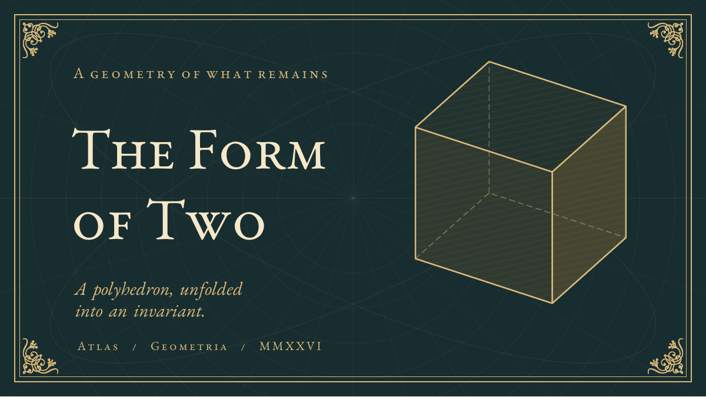 | 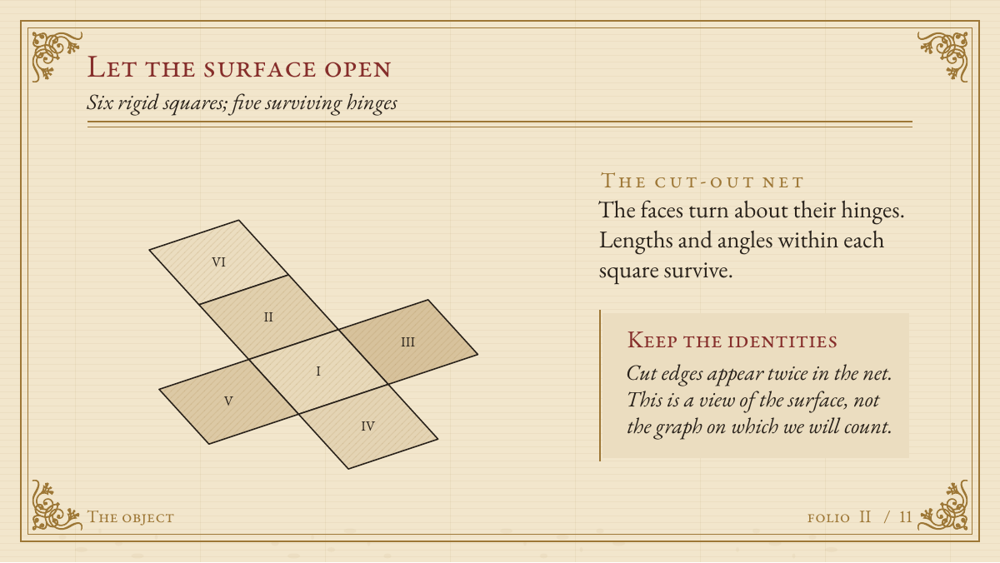 | 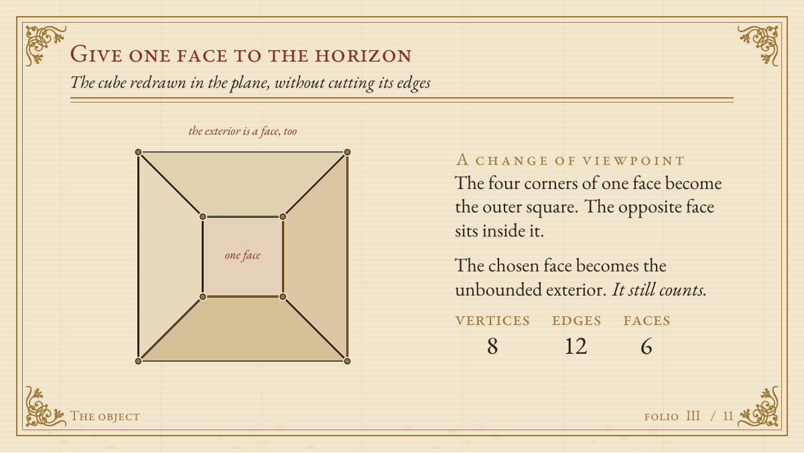 |
| The erasure | The tree | The point |
| 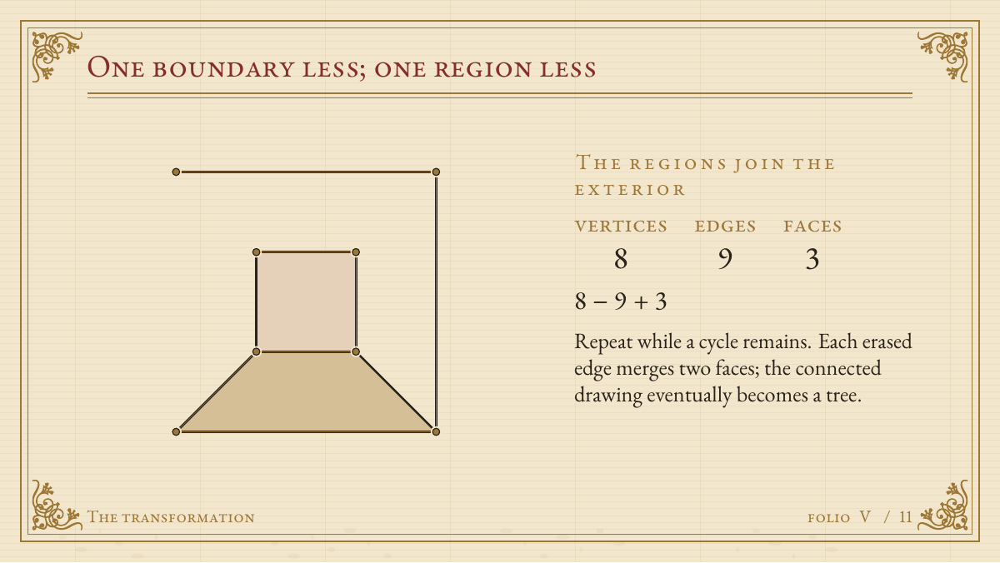 | 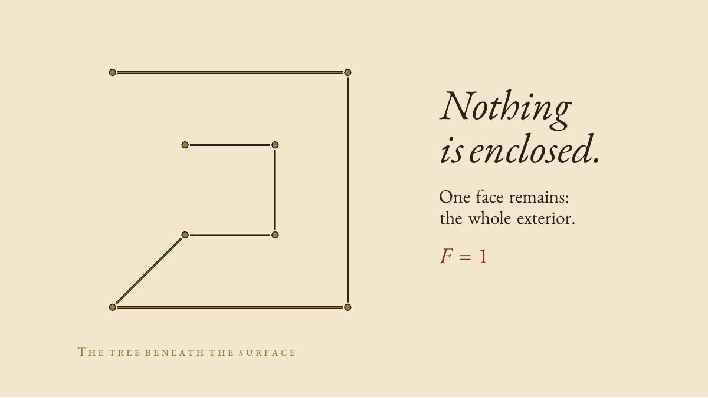 | 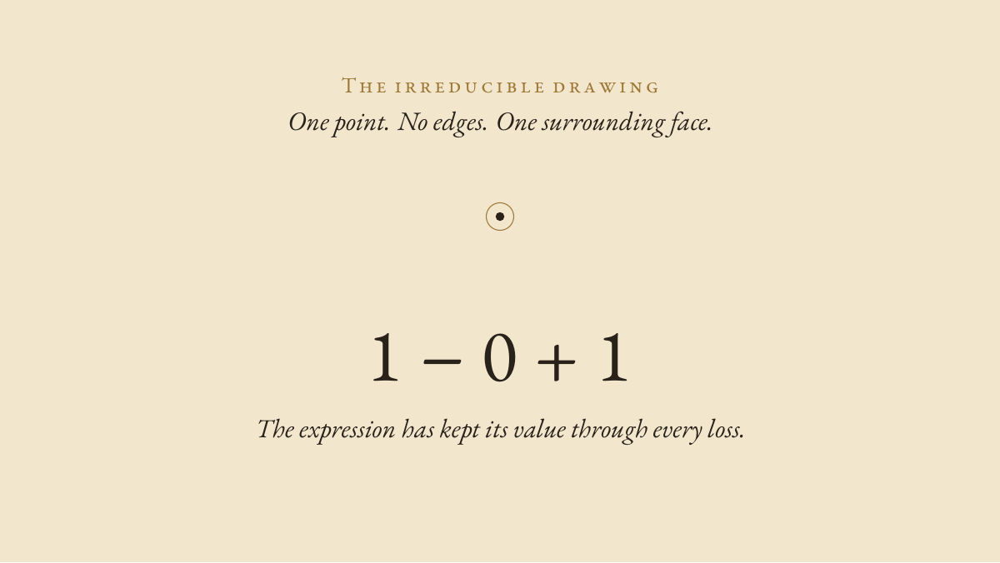 |
| The revelation | Many forms | The theorem |
| 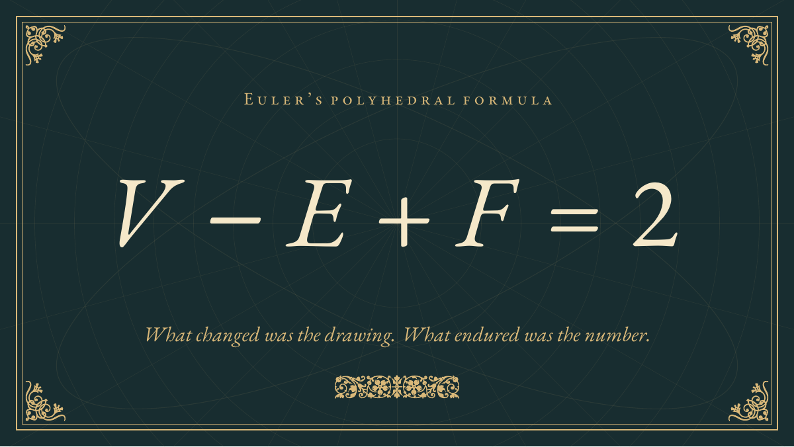 | 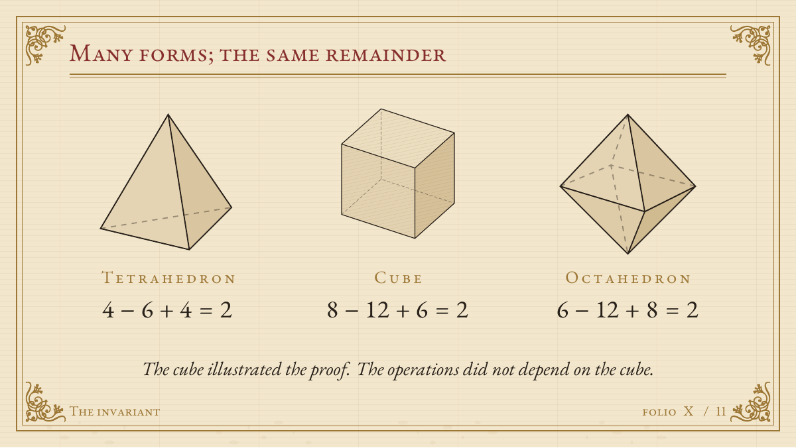 | 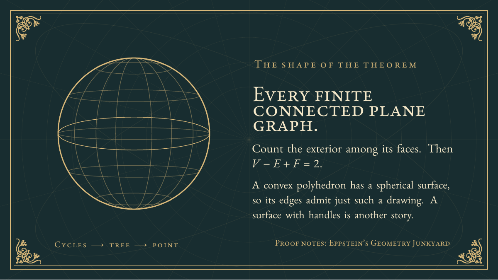 |

The presentation-local helpers live in
[euler-plates.tex](../presentations/euler-plates.tex): a quiet page treatment,
scoped dark illustration colors, engraved solids, a fixed graph stage,
and a count ledger. `tools/euler_geometry.py` generates the committed
`euler-folds.tex` from six rigid squares joined by five hinges; regenerate
it only when changing the geometry. Building the deck needs no Python
packages or external image assets.

The net is explicitly a cut surface, where some original edges appear
twice. The proof uses the uncut cube graph in a planar drawing, with the
outer region counted as a face. Its cycle-erasure argument follows
[the induction-on-faces proof collected by David Eppstein](https://ics.uci.edu/~eppstein/junkyard/euler/iface.html),
then prunes the tree to a point. The final claim concerns finite connected
plane graphs, and hence convex polyhedra. It makes no claim that the same
constant applies to surfaces with handles.

## Crawler Chronicles — the first full essay adaptation

[Crawler Chronicles](../presentations/crawler-chronicles.tex) adapts Levi
Neuwirth's main essay for an audience arriving without the Git, hosting,
or statistical background. It covers the maintenance discovery, the early
traffic, Anubis, the distributed swarm, the commit-response investigation,
and the correspondence through October 22. The appendix supplies precise
definitions and qualifications; it is not reproduced as another talk.

The result is **34 frames / 37 presentation pages**, with a 34-page handout.
The voice is first person, with comic interludes and the original Court of
Unnecessary Computation petition. All four main-essay graphs appear in full
on white evidence pages. The null-distribution and dominant-cohort panels
also appear as enlarged details. Original graph colors, labels, and data
are preserved, including the scatter's original embedded raster layer.

```sh
./build-beamer.sh --crawler
./build-beamer.sh --crawler --handout
./build-beamer.sh --crawler --plain
./build-beamer.sh --crawler --plain --handout
python3 tools/preview_crawler.py
```

PDFs are named `crawler-chronicles*.pdf` under `build/beamer/`. The overview
is `crawler-chronicles-overview.pdf`. The plain option changes the theme and
emblems to black on white; the original figures and petition retain their
source colors. Beamer `\note{...}` entries in the source carry presenter
context and statistical qualifications.

| Opening | The audience | Anubis |
|:-:|:-:|:-:|
| 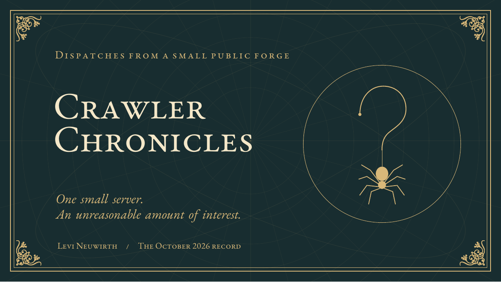 | 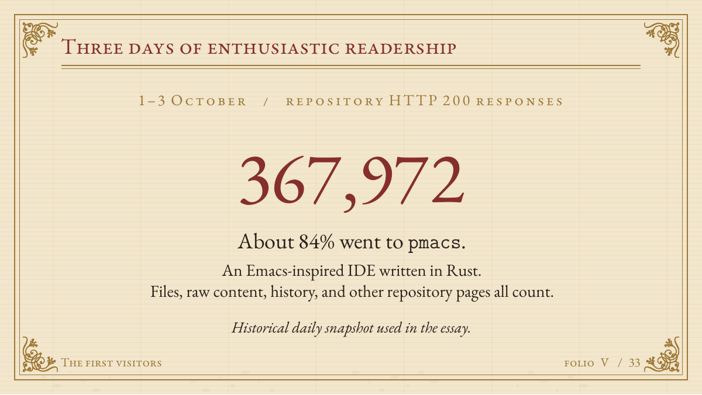 | 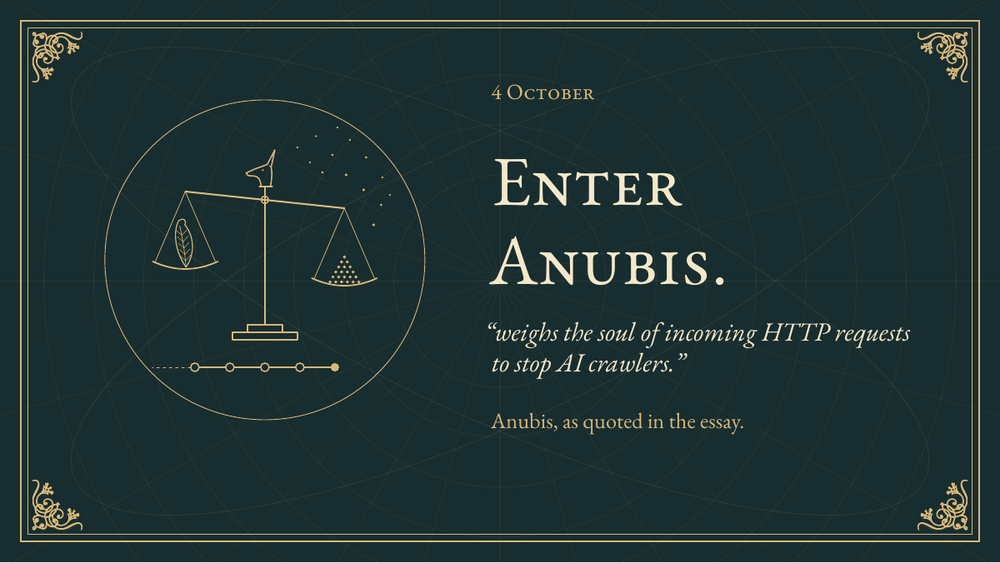 |
| Repository traffic | Publication | The timing comparison |
| 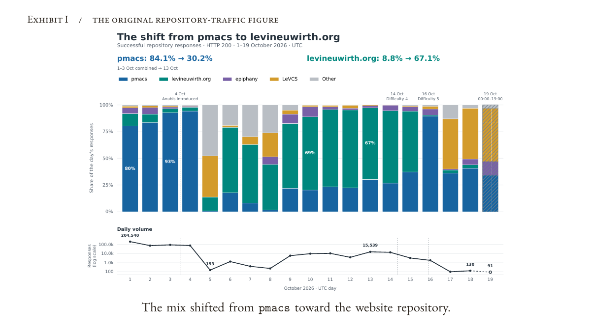 | 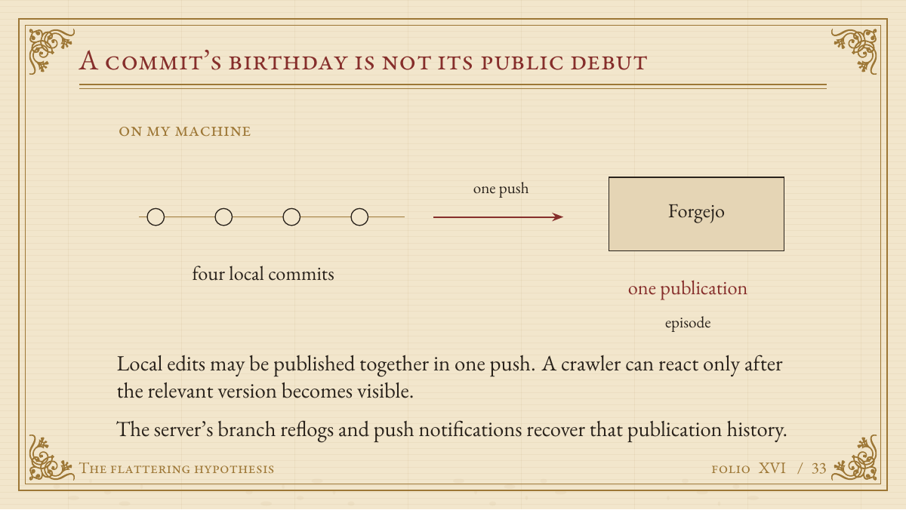 | 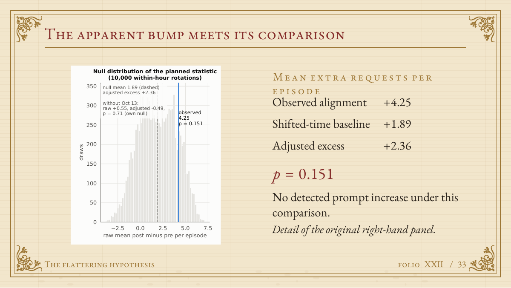 |
| Requested versions | The petition | The takeaway |
| 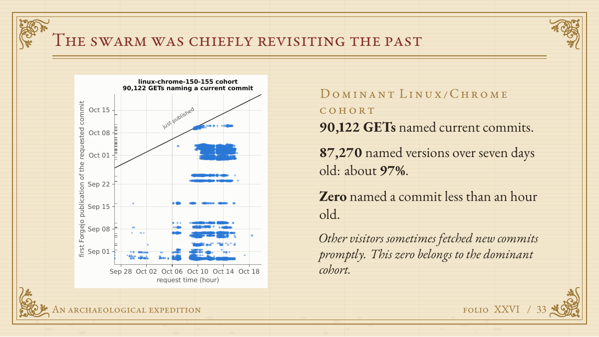 | 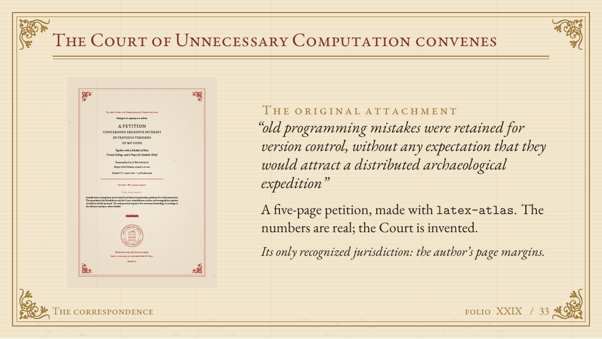 | 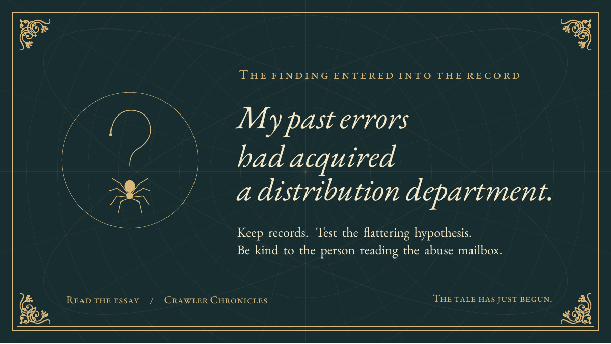 |

The deck builds from frozen assets in `presentations/crawler-assets/`, with
no dependency on the website checkout. `manifest.json` records source paths
and hashes; `adaptation.json` maps all main-essay sections to frames and
records important scope decisions. To refresh deliberately from the website:

```sh
python3 tools/import_crawler.py --source /path/to/content/essays/crawler_chronicles
```

Import requires `rsvg-convert` and `pdftocairo`. The complete original SVGs,
essay, and petition are retained under `originals/`. PDF conversions preserve
their graphics; detail views isolate original panels without redrawing data.
The petition cover is re-emitted as a vector PDF to repair a resource issue
on LuaTeX inclusion; the complete original attachment remains unchanged.

Two main-prose claims are scoped using the appendix: the 48 publication
episodes concern the website repository, and zero sub-hour commit fetches
applies to the dominant Linux/Chrome cohort. The historical daily total of
367,972 differs by one response from the figure's later hourly aggregation;
each original is retained and the difference is documented in the notes.
The figures end on October 19, so the October 22 reply is not presented as
the measured cause of their traffic decline.
