<!-- SPDX-License-Identifier: MIT -->
<!-- Copyright (c) 2026 the repository contributors -->

# Presentation guide

[Back to Atlas](../README.md). Commands below run from the repository root.

## Start a talk

The repository's `atlas` command creates, builds, previews, and checks a talk.
It uses Python 3.9+ (standard library only), LuaLaTeX, `latexmk`, and Poppler.
Preview contact sheets also use pdfLaTeX and `pdfpages`. Install the theme's
TeX packages and fonts listed below; missing fonts can use the theme's fallbacks.

```sh
./atlas new /path/to/my-talk
# Edit /path/to/my-talk/talk.tex; put figures in its assets/ directory.
./atlas build /path/to/my-talk/talk.tex
./atlas preview /path/to/my-talk/talk.tex
./atlas check /path/to/my-talk/talk.tex --all-variants
```

`new` refuses to overwrite an existing directory. The generated talk stays
independent of the specimen assets, but uses the themes from this checkout.
Invoke `atlas` by its absolute path from elsewhere, or symlink it into a
directory on your `PATH`; the symlink still locates the original theme files.

Builds resolve figure and `\input` paths relative to the deck directory.
`latexmk` reruns LuaLaTeX as needed to settle references and recorded positions,
and reuses current outputs on subsequent builds. `--plain` and `--handout`
are independent options. For `my-talk/talk.tex`, outputs are:

```text
my-talk/
  talk.tex
  LICENSE-ATLAS
  assets/
  build/talk/
    ornate/talk.pdf
    ornate-handout/talk.pdf
    plain/talk.pdf
    plain-handout/talk.pdf
```

Each variant keeps its own auxiliary files and `build.stdout.txt`. Use
`--output-dir DIR` to change the build root, or `--workdir DIR` for decks
whose relative paths assume another working directory. For example:

```sh
./atlas build presentations/atlas-grand.tex --workdir .
```

The existing `build-beamer.sh` commands remain available with their original
output locations.

`preview` builds a `.tex` deck, or reads an existing `.pdf`. It produces
1200-pixel page PNGs and a vector `overview.pdf`, up to nine slides per sheet,
in `talk-preview/` beside the PDF. By default it includes every PDF page,
including overlays. To select particular pages or unique text:

```sh
./atlas preview /path/to/my-talk/talk.tex --handout
./atlas preview /path/to/talk.pdf --pages 1,3-7
./atlas preview /path/to/talk.pdf --match 'The full comparison' --match 'Give the evidence room.'
```

Text selections must match exactly one page; use page numbers for repeated
overlay titles. The preview manifest records the source and selected pages.

`check` forces a rebuild, reports LaTeX warnings, overfull/underfull boxes,
missing glyphs, and extracted text within one point of or beyond a page edge.
It writes `check.json` beside each checked PDF. Exit status is zero only when
the build succeeds and no findings remain; findings and operational errors
return nonzero. `--all-variants` checks all four combinations. These bounds
are a review aid: they cannot detect every clipped graphic, overlapping
element, or visual imbalance. Inspect the previews too.

Run the CLI regression checks with:

```sh
python3 -m unittest discover -s tools -p 'test_*.py'
```

### Continuous integration

[GitHub Actions](https://github.com/levineuwirth/latex-atlas/actions/workflows/ci.yml)
runs on pushes to `main`, pull requests, and manual dispatch. The fast jobs
test Python 3.9 and 3.14, verify the frozen Crawler source hashes, and audit
the Euler geometry. A separate Ubuntu 24.04 job installs TeX and runs real
presentation checks:

- A newly created talk outside the checkout, in all four variants.
- A deck with relative figure and TeX includes, spaces in filenames, and a
  forward reference.
- Atlas, Grand, Euler, and Crawler specimens, with expected page counts.
- A selected-slide preview and the full Crawler overview across five sheets.

The `presentation-checks` artifact contains PDFs, PNGs, reports, and build
logs for seven days, including diagnostics from failed runs. Builds use
only committed assets; the website checkout is not required. Page counts
are intentional regression expectations in `tools/ci_smoke.py`; update
them alongside intentional slide or overlay changes.

To run the integration checks locally with TeX and Poppler installed:

```sh
python3 tools/ci_smoke.py
```

Outputs go to the ignored `build/ci/` directory. Automated checks cover
compilation and text bounds; the artifacts still need a visual review
when the design changes.
CI also [builds and checks the release bundle](releases.md) and uploads it
as a separate `release-candidate` artifact.

### The starter source

Copy [presentations/starter.tex](../presentations/starter.tex). It is a single
editable file with six patterns: a dark opening, ordinary content with
overlays, a full-page figure, an enlarged detail, a quiet italic quotation,
and a closing takeaway. The illustrative chart is drawn inside the file;
there are no dependencies on the specimen decks or website assets.

```sh
./build-beamer.sh --starter                  # build/beamer/atlas-starter.pdf
./build-beamer.sh --starter --handout        # six pages; overlays collapsed
./build-beamer.sh --starter --plain          # black-on-white theme
./build-beamer.sh --starter --plain --handout
python3 tools/preview_starter.py              # six-pattern overview and gallery
```

The presentation has six frames and seven pages because the ordinary
content slide reveals two items. Edit the metadata at the top, then the
six marked sections. Replace `\TalkFigure` and `\TalkDetail` with your own
PDF/image inclusions; the comments give size limits and examples. Keep the
axes and legends needed to interpret a detail. Quiet-page and dark-palette
changes are scoped to their frames. Speaker notes use ordinary `\note{...}`.

For a copied file outside the repository, compile with LuaLaTeX three times,
with the repository's `sty/` directory on the TeX search path:

```sh
TEXINPUTS=/path/to/latex-atlas/sty: lualatex talk.tex
TEXINPUTS=/path/to/latex-atlas/sty: lualatex talk.tex
TEXINPUTS=/path/to/latex-atlas/sty: lualatex talk.tex
```

| Opening | Ordinary content | Full figure |
|:-:|:-:|:-:|
| 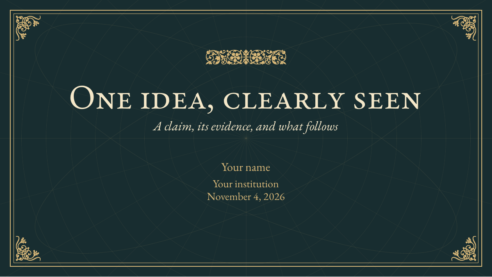 | 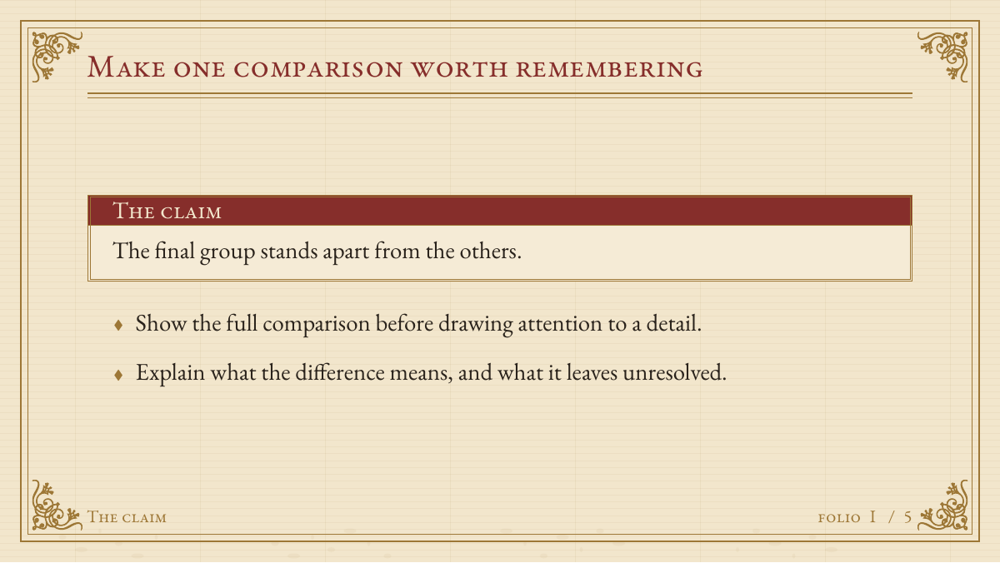 | 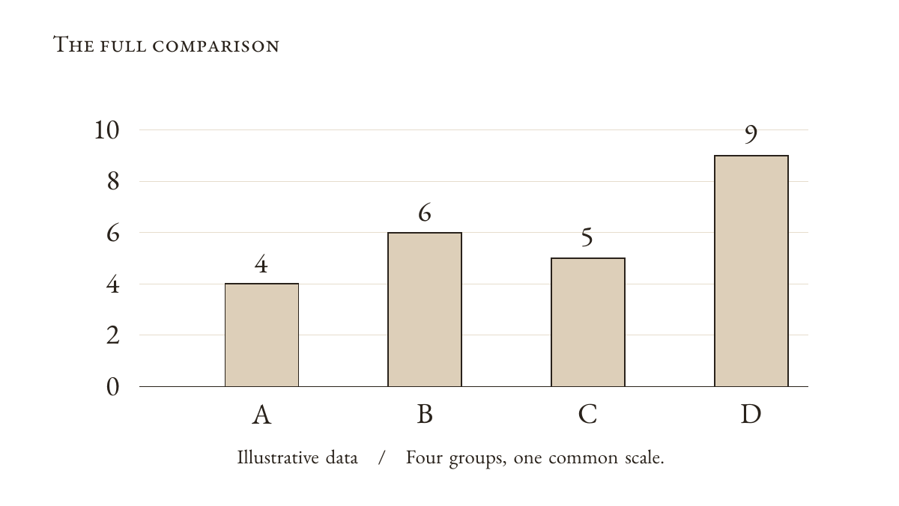 |
| Detail | Quiet quotation | Closing |
| 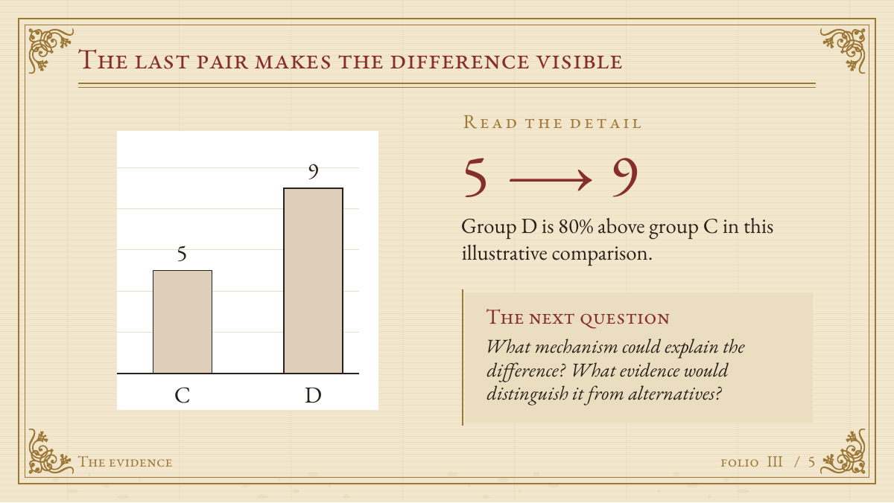 | 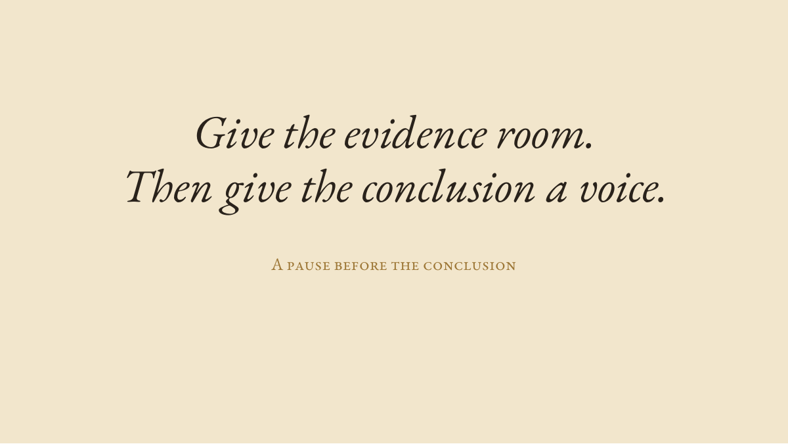 | 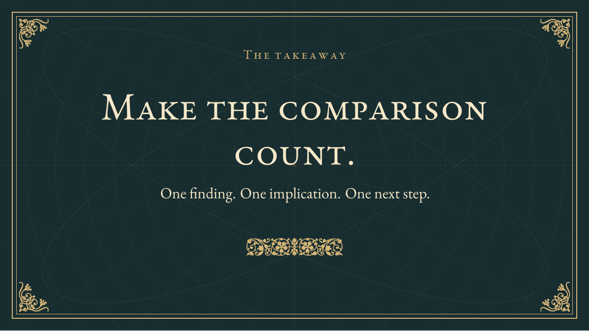 |

## Beamer

```latex
\documentclass[aspectratio=169,12pt]{beamer}
\usetheme{Atlas}
\title{A presentation}
\author{Your name}
\date{}
\begin{document}
\begin{frame}[plain,noframenumbering]
  \titlepage
\end{frame}
\begin{frame}{An observation}
  Ordinary Beamer content, including math, blocks, and overlays.
\end{frame}
\end{document}
```

Compile with **LuaLaTeX**, with `sty/` on `TEXINPUTS`, twice to resolve
references and the frame count. The theme is `sty/beamerthemeAtlas.sty`;
load it with `\usetheme{Atlas}`. It is independent of the article packages
`atlas` and `atlas-grand`; do not load those in a presentation.

Build [the specimen deck](../presentations/atlas.tex) from the repository:

```sh
./build-beamer.sh                     # build/beamer/atlas.pdf
./build-beamer.sh --plain             # atlas-plain.pdf: black on white
./build-beamer.sh --handout           # atlas-handout.pdf: collapsed overlays
./build-beamer.sh --plain --handout   # atlas-plain-handout.pdf
```

For your own deck, point to this repository's `sty/` directory:

```sh
TEXINPUTS=/path/to/latex-atlas/sty: lualatex talk.tex
TEXINPUTS=/path/to/latex-atlas/sty: lualatex talk.tex
```

The first version styles the title page, frame titles and subtitles,
numbered theorems, proofs, lists, blocks, and frame numbers. Beamer keeps
control of sections, references, overlays, and page size. The specimen
uses 16:9 at 12 pt; those are document options, not theme requirements.
The title frame above is unnumbered, and overlays share a frame number.

The specimen now includes an argument in motion: a large theorem statement,
a six-step cop-and-robber chase on a fixed tree, and a diagram beside a
three-step proof. Advance PDF pages to move through the overlays; these are
speaker-paced steps, with no timer or special PDF animation support needed.
The cop and robber have distinct lettered pieces, while halos and dashed
branches show the shrinking region. The handout keeps an intermediate
position and a table of the complete chase, followed by the full proof.
These slide patterns live in [presentations/tree-pursuit.tex](../presentations/tree-pursuit.tex)
and use ordinary Beamer and TikZ commands, independently of the theme.

Use `\usetheme[plain]{Atlas}` for black on white and the Beamer class's
`handout` option to collapse overlays. These are independent choices.
Customize individual elements with normal `\setbeamercolor`,
`\setbeamerfont`, and `\setbeamertemplate` calls after loading the theme.
The named colors are `AtlasPaper`, `AtlasInk`, and `AtlasRubric`.

Requirements: LuaLaTeX, Beamer, `fontspec`, `unicode-math`, EB Garamond
and Garamond-Math (with TeX Gyre Pagella and Pagella Math as fallbacks).
The specimen also uses TikZ and `booktabs`. This is an initial theme for
visual exploration; projection readability still needs an actual room.

## The grand edition

`\usetheme{AtlasGrand}` is the maximalist investigation: gilded double
borders and corner ornaments, laid and chain lines, illuminated initials,
framed theorem blocks, marginal scholia, Roman folios, and dark astronomical
chapter openings. It loads the Beamer `Atlas` theme, not the old article
package `atlas-grand`.

[The grand specimen](../presentations/atlas-grand.tex) expands the argument
into an engraved mathematical atlas. Its illustrations include an armillary
frontispiece, medallion player pieces, a seven-segment countdown dial,
hatched territory bars, and animated one- and two-cop cycle plates.
Everything is vector; the overlays advance with the speaker. The handout
keeps a single coherent position and the whole argument on each frame.

```sh
./build-beamer.sh --grand                     # atlas-grand.pdf
./build-beamer.sh --grand --handout           # atlas-grand-handout.pdf
./build-beamer.sh --grand --plain             # atlas-grand-plain.pdf
./build-beamer.sh --grand --plain --handout   # atlas-grand-plain-handout.pdf
python3 tools/preview_grand.py                # gallery + vector PDF overview
```

All PDFs are in `build/beamer/`. Grand builds take three LuaLaTeX passes
to settle the positions of the page ornaments. The preview command makes
`atlas-grand-overview.pdf`, a nine-plate contact sheet, and the gallery
below. It requires Poppler and pdfLaTeX (the latter only combines existing
PDF pages). Preview selections follow text in the deck, rather than fixed
page numbers.

| Frontispiece | Chapter opening | Proposition |
|:-:|:-:|:-:|
| 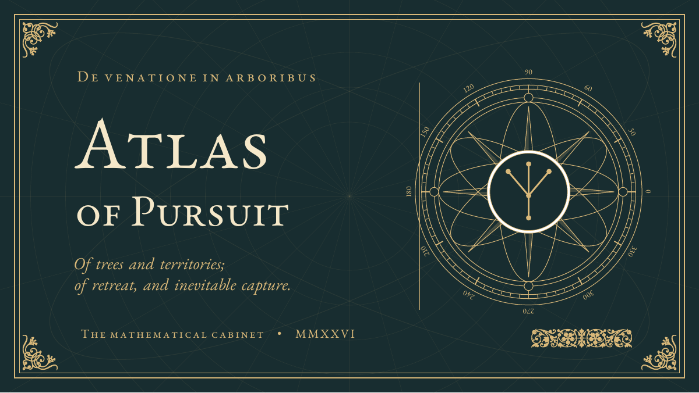 | 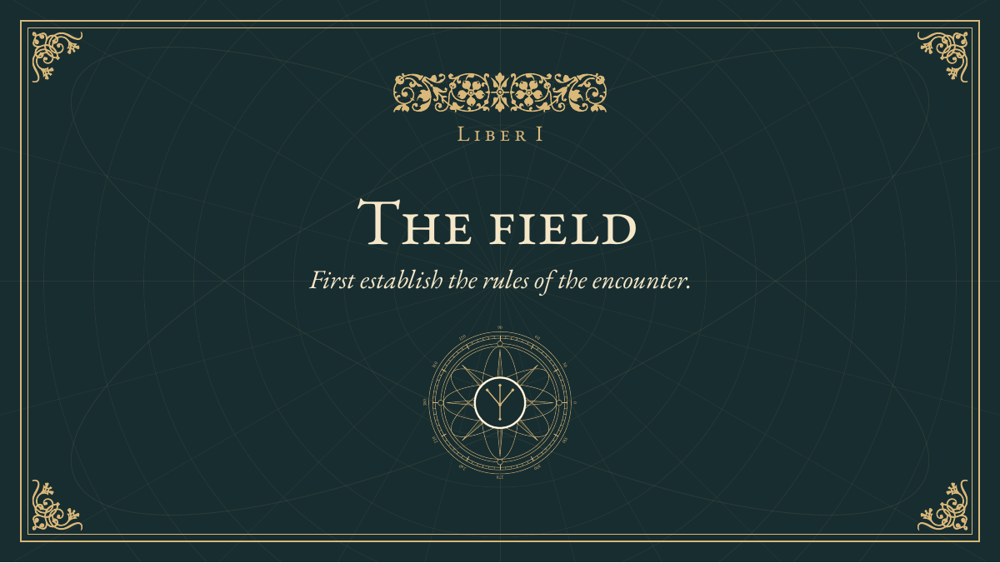 | 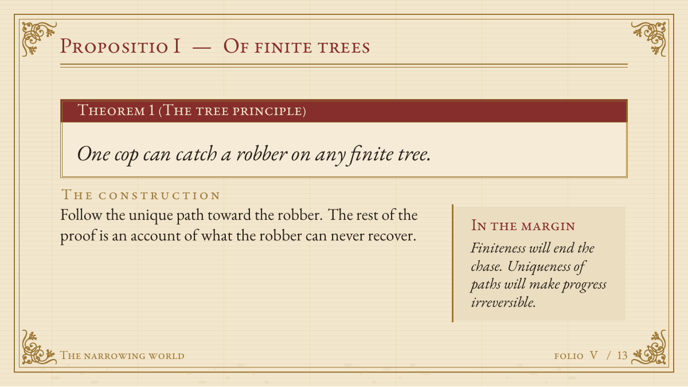 |
| Chase | Working proof | Hatched chart |
| 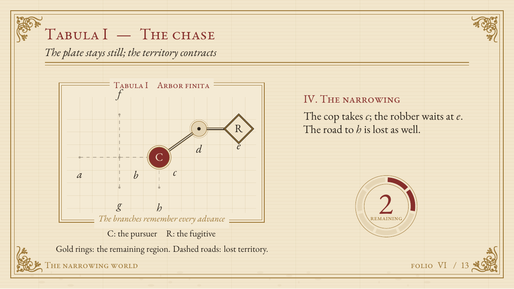 | 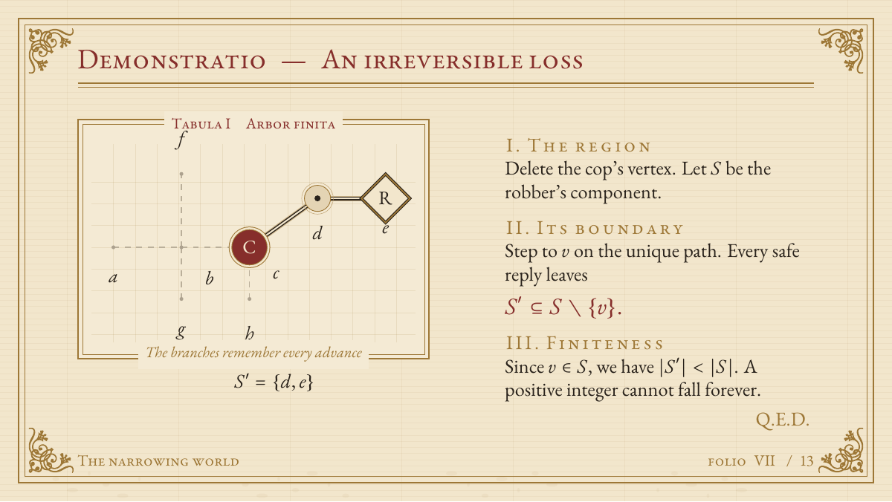 | 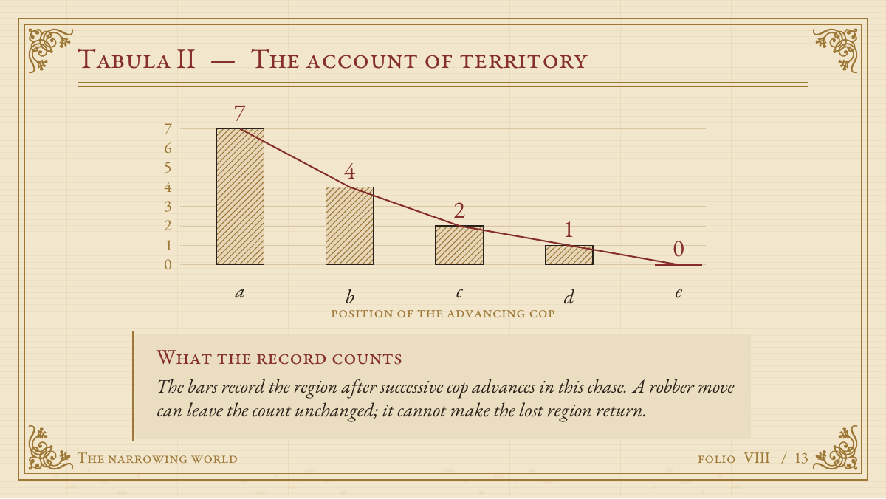 |
| Two boundaries | Marginalia | Finis |
| 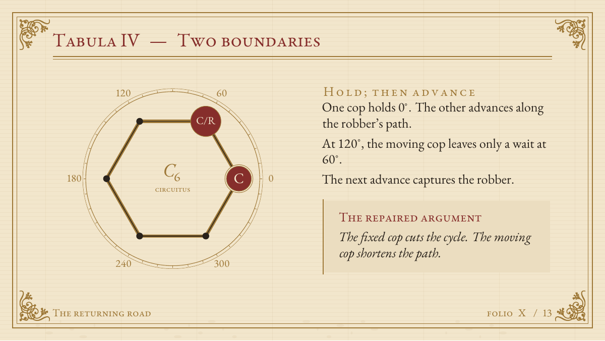 | 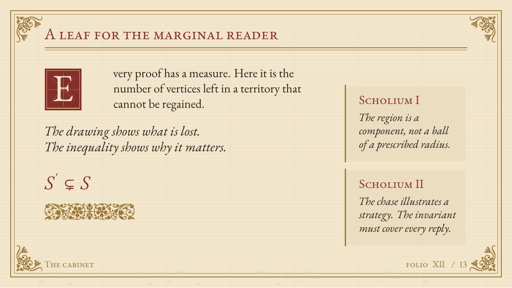 | 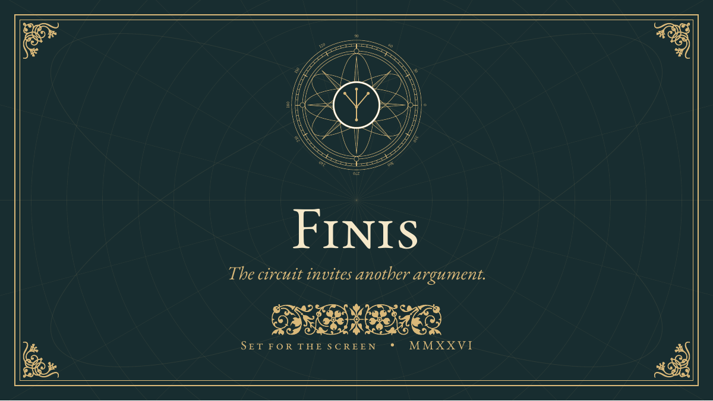 |

For another deck, use the normal Beamer metadata and `\titlepage`, then
ordinary frames, theorems, proofs, lists, and blocks. The grand helpers are:

| Command | Purpose |
|---|---|
| `\AtlasGrandChapter{II}{Title}{Subtitle}` | An unnumbered dark chapter slide |
| `\AtlasGrandScholium{Heading}{Text}` | A marginal note panel; place in a column |
| `\AtlasGrandInitial{A}` | A framed illuminated letter; the specimen shows its placement |
| `\AtlasGrandFleuron[25mm]` | A scalable ornament |
| `\AtlasGrandKicker{Text}` | A small gold heading |
| `\AtlasGrandRubric{Text}` | Spaced small capitals in rubric |
| `\AtlasGrandAstrolabe[55mm]` | The vector instrument, designed for dark frames |

For a custom dark slide, scope the palette around its frame:

```latex
{\AtlasGrandNight
\begin{frame}[plain,noframenumbering]
  \centering
  \AtlasGrandAstrolabe[35mm]\par\bigskip
  {\Huge\scshape Finis\par}
\end{frame}}
```

`[plain]` keeps the ornament but uses black, white, and grays, including on
the chapter slides. Additional theme dependencies are `pgfornament`, TikZ,
`tcolorbox`, and `microtype`. The custom specimen is composed for 16:9 at
11 pt; its plates live in [grand-plates.tex](../presentations/grand-plates.tex).
The theme also supports ordinary 4:3 frames. This edition intentionally
tests excess; it does not establish a new requirement for subsequent work.

## The Form of Two — an Euler spectacle

[The second grand specimen](../presentations/atlas-euler.tex) explores scale,
depth, and pacing across twelve composed frames (29 presentation pages).
An engraved cube opens on five hinges into a six-square net. A separate
planar drawing then carries the proof: cycle edges disappear, faces merge,
and the remaining tree loses its leaves until only one point remains.
The final formula receives the largest type in the deck.

Bare, unframed pages interrupt the ornament. The tree and point occupy
those quieter pages; the dark astronomical field returns for the equation.
This is a second composition using `AtlasGrand`, not another theme fork.

```sh
./build-beamer.sh --euler                     # atlas-euler.pdf
./build-beamer.sh --euler --handout           # atlas-euler-handout.pdf
./build-beamer.sh --euler --plain             # atlas-euler-plain.pdf
./build-beamer.sh --euler --plain --handout   # atlas-euler-plain-handout.pdf
python3 tools/preview_euler.py                # gallery + nine-plate PDF overview
python3 tools/check_euler.py                  # independent graph/geometry audit
```

Outputs are in `build/beamer/`; the handouts have twelve pages. Advance PDF
pages to unfold the solid and perform individual graph operations. No
special viewer animation support is required. The handout keeps the open
net, final graph states, full reasoning, and the face-erasure count trace.

| The object | The unfolding | The plane |
|:-:|:-:|:-:|
| 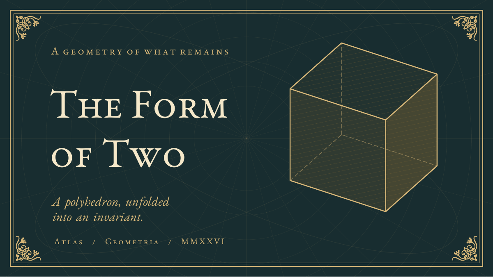 | 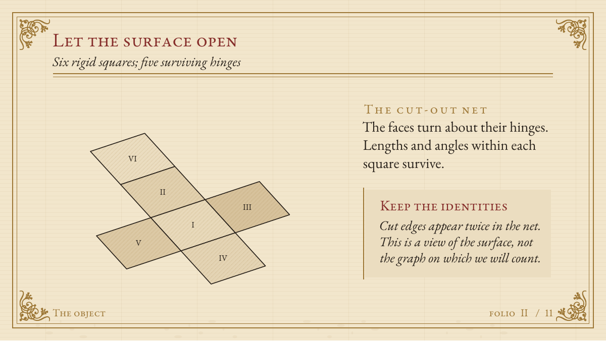 | 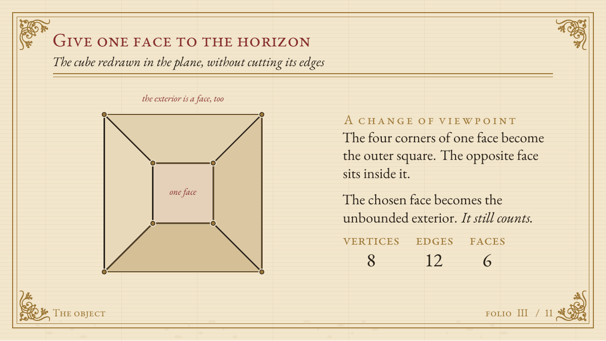 |
| The erasure | The tree | The point |
| 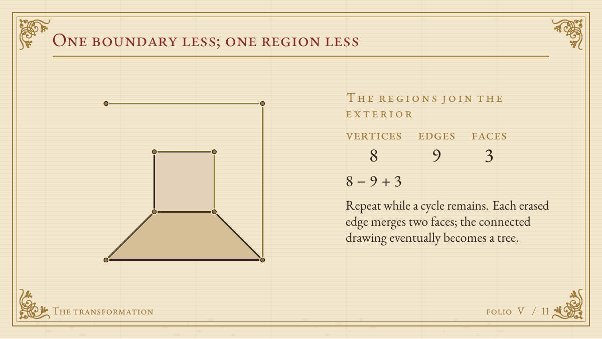 | 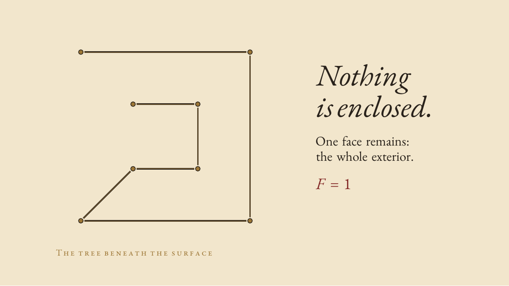 | 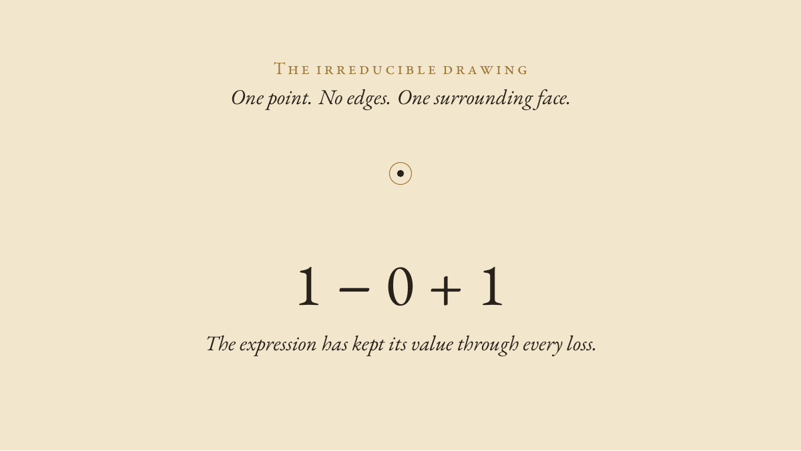 |
| The revelation | Many forms | The theorem |
| 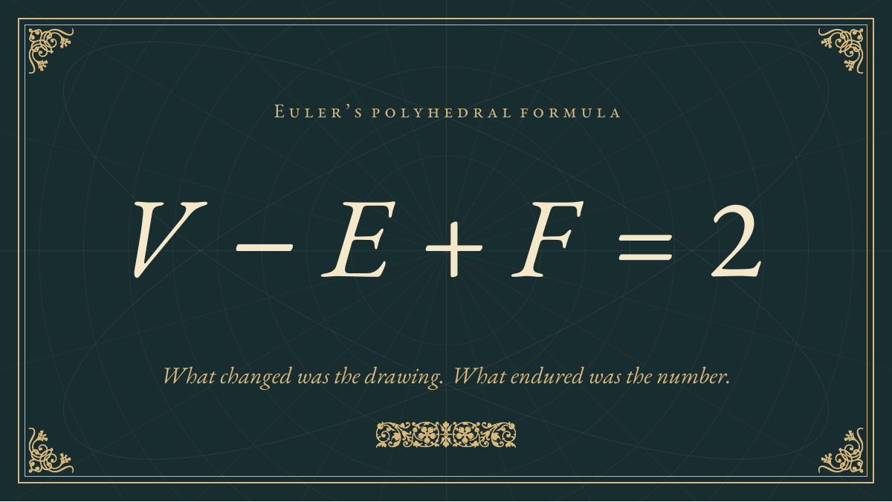 | 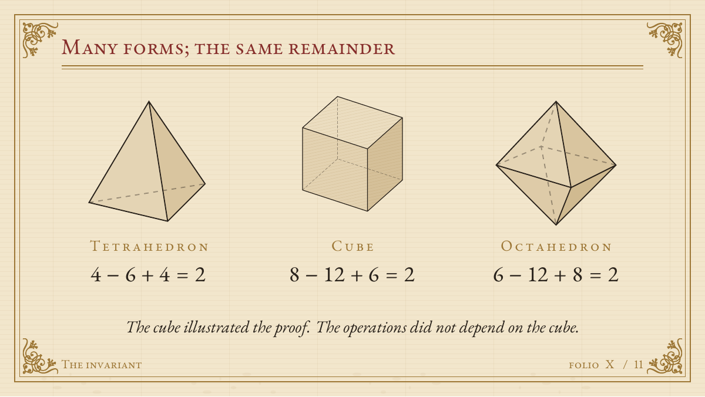 | 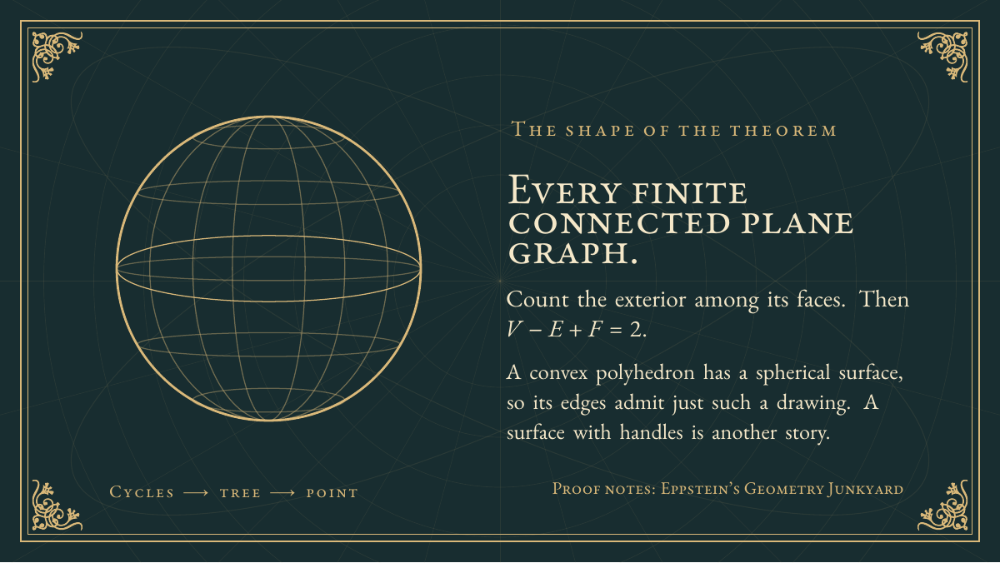 |

The presentation-local helpers live in
[euler-plates.tex](../presentations/euler-plates.tex): a quiet page treatment,
scoped dark illustration colors, engraved solids, a fixed graph stage,
and a count ledger. `tools/euler_geometry.py` generates the committed
`euler-folds.tex` from six rigid squares joined by five hinges; regenerate
it only when changing the geometry. Building the deck needs no Python
packages or external image assets.

The net is explicitly a cut surface, where some original edges appear
twice. The proof uses the uncut cube graph in a planar drawing, with the
outer region counted as a face. Its cycle-erasure argument follows
[the induction-on-faces proof collected by David Eppstein](https://ics.uci.edu/~eppstein/junkyard/euler/iface.html),
then prunes the tree to a point. The final claim concerns finite connected
plane graphs, and hence convex polyhedra. It makes no claim that the same
constant applies to surfaces with handles.

## Crawler Chronicles — the first full essay adaptation

[Crawler Chronicles](../presentations/crawler-chronicles.tex) adapts Levi
Neuwirth's main essay for an audience arriving without the Git, hosting,
or statistical background. It covers the maintenance discovery, the early
traffic, Anubis, the distributed swarm, the commit-response investigation,
and the correspondence through October 22. The appendix supplies precise
definitions and qualifications; it is not reproduced as another talk.

The result is **34 frames / 37 presentation pages**, with a 34-page handout.
The voice is first person, with comic interludes and the original Court of
Unnecessary Computation petition. All four main-essay graphs appear in full
on white evidence pages. The null-distribution and dominant-cohort panels
also appear as enlarged details. Original graph colors, labels, and data
are preserved, including the scatter's original embedded raster layer.

```sh
./build-beamer.sh --crawler
./build-beamer.sh --crawler --handout
./build-beamer.sh --crawler --plain
./build-beamer.sh --crawler --plain --handout
python3 tools/preview_crawler.py
```

PDFs are named `crawler-chronicles*.pdf` under `build/beamer/`. The overview
is `crawler-chronicles-overview.pdf`. The plain option changes the theme and
emblems to black on white; the original figures and petition retain their
source colors. Beamer `\note{...}` entries in the source carry presenter
context and statistical qualifications.

| Opening | The audience | Anubis |
|:-:|:-:|:-:|
| 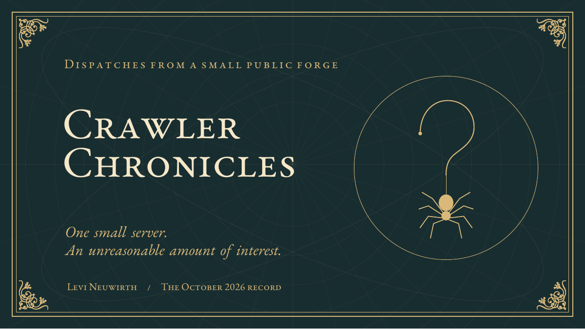 | 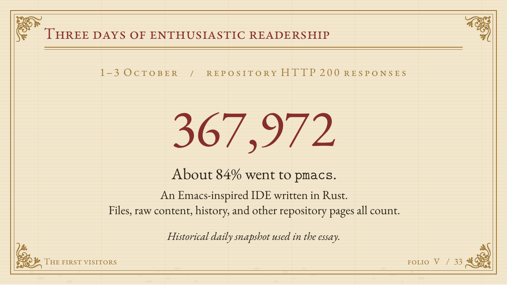 | 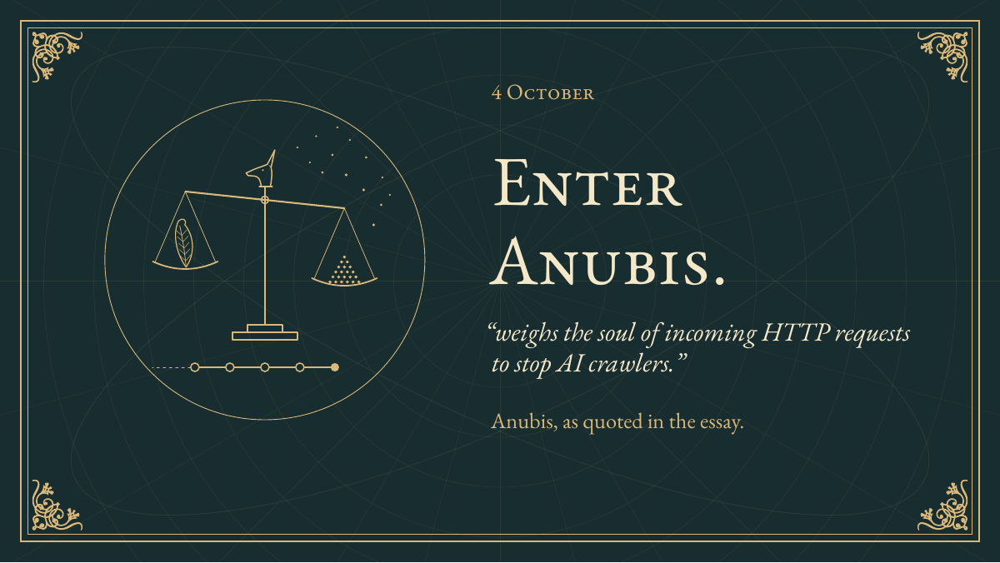 |
| Repository traffic | Publication | The timing comparison |
| 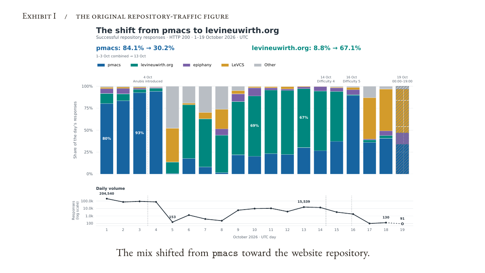 | 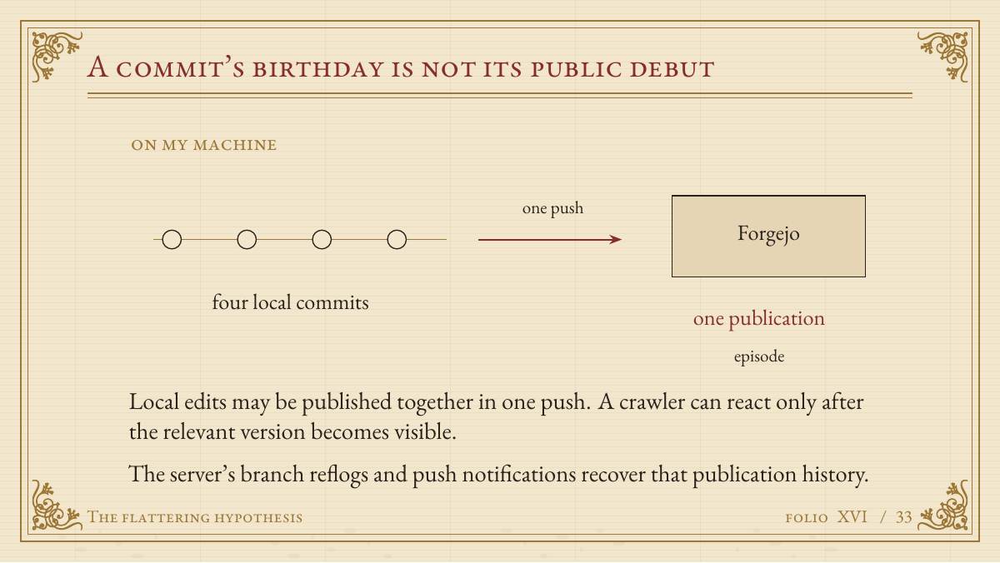 | 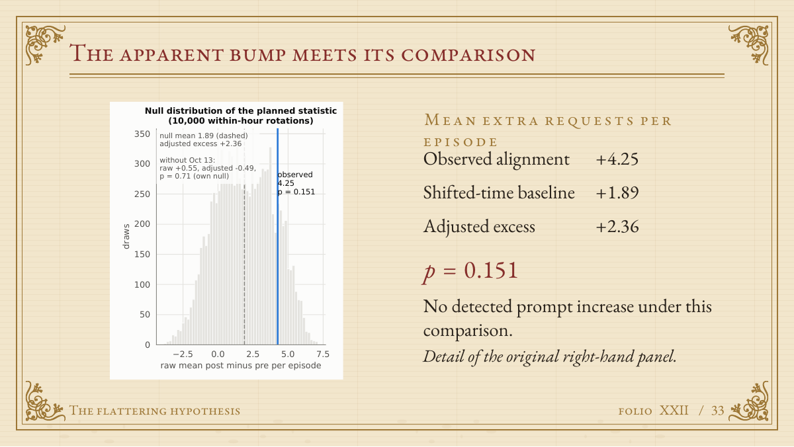 |
| Requested versions | The petition | The takeaway |
| 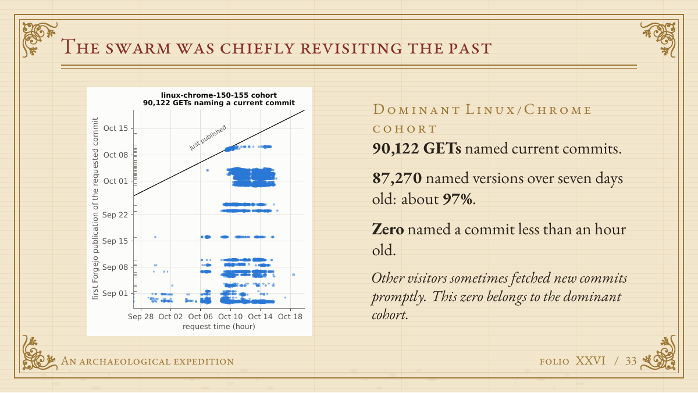 | 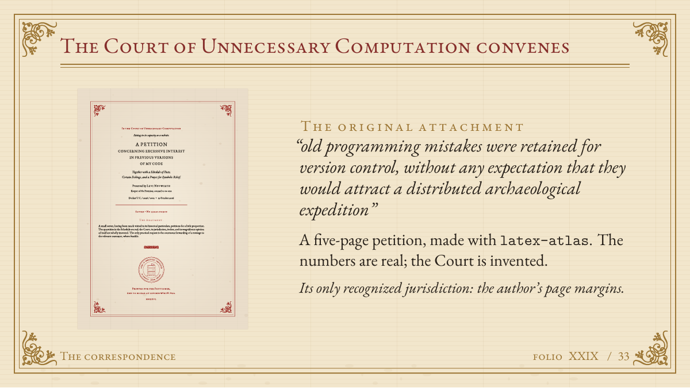 | 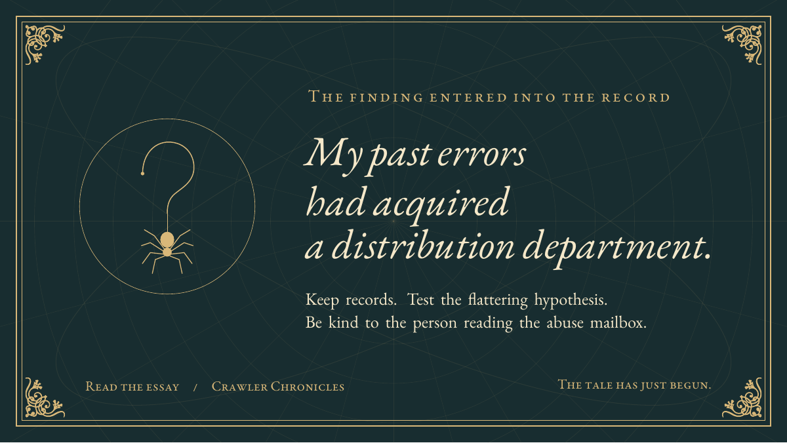 |

The deck builds from frozen assets in `presentations/crawler-assets/`, with
no dependency on the website checkout. `manifest.json` records source paths
and hashes; `adaptation.json` maps all main-essay sections to frames and
records important scope decisions. To refresh deliberately from the website:

```sh
python3 tools/import_crawler.py --source /path/to/content/essays/crawler_chronicles
```

Import requires `rsvg-convert` and `pdftocairo`. The complete original SVGs,
essay, and petition are retained under `originals/`. PDF conversions preserve
their graphics; detail views isolate original panels without redrawing data.
The petition cover is re-emitted as a vector PDF to repair a resource issue
on LuaTeX inclusion; the complete original attachment remains unchanged.

Two main-prose claims are scoped using the appendix: the 48 publication
episodes concern the website repository, and zero sub-hour commit fetches
applies to the dominant Linux/Chrome cohort. The historical daily total of
367,972 differs by one response from the figure's later hourly aggregation;
each original is retained and the difference is documented in the notes.
The figures end on October 19, so the October 22 reply is not presented as
the measured cause of their traffic decline.
